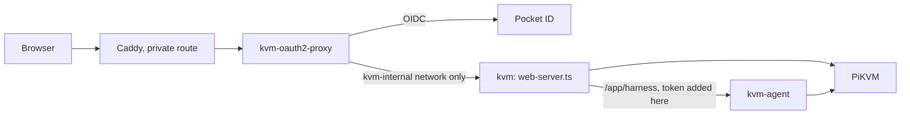

# PiKVM Desktop

A chat-first desktop workspace for supervised computer use. Bring an OAuth- or
API-backed model, connect a managed PiKVM/VNC target, ask for an outcome in
plain language, and watch planning, exact tool calls, screen transitions,
verification, and approvals in one conversation.

The desktop owns two local services:

- the provider-neutral chat and operator harness;
- the machine-control daemon selected at runtime.

The model never receives a VNC address, PiKVM credential, browser token, or
approval capability. Normal Claude MCP compatibility exposes only the five
high-level managed computer controls. The first-party harness—not Claude
Code—plans, selects bounded input, verifies the resulting frame, and handles
recovery. Guarded direct MCP remains available only with the explicit
`--control-mode direct` launcher argument.

## Development

```bash
yarn install
yarn build
yarn test
yarn start
```

Yarn, not npm: `yarn.lock` is the lockfile under version control, and a stray
`package-lock.json` from an `npm install` is how the two drift apart.

`PIKVM_AGENT_DAEMON`, `PIKVM_HARNESS_ORIGIN`, `PIKVM_AGENT_CONFIG`, and
`PIKVM_HARNESS_CONFIG` select local runtime services without hard-coding a
computer endpoint. Use `PIKVM_AGENT_FAKE=1` for target-free development.

The ordinary MCP entrypoint is:

```bash
node dist/mcp-launcher.js \
  --runtime "/path/to/owner-only/harness-runtime.json" \
  --caller-label claude-cli
```

The default launches `harness managed-mcp`. Direct compatibility must be
requested deliberately:

```bash
node dist/mcp-launcher.js \
  --runtime "/path/to/owner-only/harness-runtime.json" \
  --caller-label claude-cli \
  --control-mode direct
```

The runtime handoff is mode `0600`, tied to the live desktop process, and never
contains the browser operator token or daemon approval capability.

## The PiKVM address and credentials

In the desktop app, Settings > Connection edits the PiKVM address, user name and password; the change
applies at once (the proxy and the control core follow it) and the app reloads. A hosted web build keeps
them read-only, pinned by its environment.

`pikvm.json` in the app's user data folder holds the address and user name. The password is in
`pikvm-credentials.json` beside it, mode 0600, written through a temporary file and a rename into a
folder that is 0700 when the app created it. It is write-only: no API reply, log line or error carries it,
and the form never shows it. Installs from before this kept `user:pass` inside the address; that is still
read, never rewritten at startup, and moves to the credentials file the first time you save from Settings.
The API is `GET`/`PUT /app/api/v1/target` (`@pikvm/contracts`); a host that pins the PiKVM answers
`403` to the `PUT`.

## Packaging

The desktop app is an Electron app whose one window loads the embedded server's `/app/`; its only
bridge to the OS is `window.pikvmDesktop` (`packages/contracts/src/desktop.ts`, implemented in
`src/desktop/`). Packages are written by [pkgsmith](https://github.com/kierandrewett/pkgsmith) from
`pkgsmith.star`:

| System | Formats | Notes |
| --- | --- | --- |
| Linux (x64, arm64) | rpm, deb, Arch (`.pkg.tar.zst`), AppImage, Flatpak | needs `flatpak` on PATH for the Flatpak |
| macOS (arm64, x64) | dmg, zip | unsigned, not notarised |
| Windows (x64) | nsis, zip | needs `makensis` on PATH for nsis; unsigned. No msi yet: pkgsmith's msi writer overflows on the runtime's 24,000 files |

```bash
make package          # build, then every format for THIS machine's platform
# -> builds/packages/<platform>-<arch>/
node scripts/package.mjs --formats rpm,deb     # some formats
node scripts/package.mjs --tree-only           # just the Electron tree in builds/
```

`make package` builds the agent runtime first (`make agent-runtime`, a CPython for this platform, about
800MB), then `scripts/package.mjs` runs the builds, has electron-packager write the Electron tree,
fills its `resources/` (web app, harness UI, terminal addon, agent runtime) and runs
`pkgsmith build` over that tree. Point `PKGSMITH` at the binary if it is not on PATH; pkgsmith has no
release yet, so build it from its repository (`cargo build --release --workspace`; its plugins must
sit beside the binary). The package release is `<commit count>.<timestamp>` (plus `.dirty`), so a
rebuild is always a different package to `dnf` and `apt`.

A tree for another platform can be made anywhere (`--platform win32 --arch x64 --tree-only`). The agent
runtime is a CPython built for one platform: Linux and macOS ones must be built on that platform, but
the Windows one cross-builds from any host (`node scripts/build-agent-runtime.mjs --platform win32
--arch x64` into `agent/runtime-win32-x64`: the standalone Windows CPython, the locked dependencies as
Windows wheels, and a `pikvm-agent.exe` launcher that finds `python.exe` beside itself). So the macOS
packages come from `.github/workflows/package.yml`, which runs the build on a runner of each system and
uploads the packages as artefacts. The icon sizes in `packaging/icons` come from `make icons`.

## Web host

`src/web-server.ts` runs the console and the PiKVM proxy without Electron, for
phones and browsers. It has no shared terminal. Chat works there too: the host
forwards `/app/harness/*`, with an operator token the browser never sees, to an
agent sidecar (`deploy/agent`: the daemon and the harness, with the `claude` and
`codex` CLIs) or to the desktop app. [docs/deploy-web.md](docs/deploy-web.md) has
the variables and the exact compose block for both.

```bash
make web-bundle agent-bundle         # builds/web/ and builds/agent/: Docker contexts
docker build -t pikvm-web builds/web
docker build -t pikvm-agent builds/agent
```

The environment is the whole contract; the header of `src/web-server.ts` lists
every variable. The host has no login of its own. Run it behind an
authenticating proxy that is the ONLY route in, and set `PIKVM_AUTH=proxy`;
without that it refuses to bind anything but loopback. Publishing its port
directly would put the KVM on the network with no sign-in.

The bsociety deployment (`/srv/machines/bsociety/kvm/compose.yml`) is the
reference:



Let these public static paths through the authenticating proxy without sign-in
(oauth2-proxy: `--skip-auth-route` or `skip_auth_routes`), because browsers
fetch them without cookies and the installed app needs them before anyone is
signed in:

```
GET=^/app/manifest\.webmanifest$
GET=^/app/sw\.js$
GET=^/app/(icon|icon-192|icon-512|apple-touch-icon)\.png$
```

Everything else under `/app/`, and everything the host proxies to the Pi, stays
behind sign-in. The idle jiggler is off unless `PIKVM_JIGGLER=1` sets its
first value; once it has been changed in Settings (`PATCH /app/api/v1/settings`)
the saved value wins.

On a touch screen the console docks its controls above the soft keyboard, in
the desktop titlebar's style: speaker, mic, paste, keyboard and ⋯ in the bar,
then rows of modifier and navigation keys (Fn and More open F1-F12 and the
common shortcuts). ⋯ opens as a sheet in the bar; it also holds the mouse
buttons and the input settings. Trackpad mode (the default) moves the cursor
by drag and taps click. Holding still for half a second arms the touch: move
to drag with the left button held, or lift to right-click. Quick swipes never
press a button. Two fingers scroll,
pinch zooms on the cursor and the view follows it, and a lens at the cursor
magnifies what is under it. Touch mode points where you tap. The trackpad uses
the Pi's absolute mouse by default; relative is in ⋯ for targets that need it.

Installed as an app (PWA), it keeps the screen on while open, reconnects after
being in the background, and shows a "Can't reach the KVM" screen that
retries by itself when the host is out of reach.
