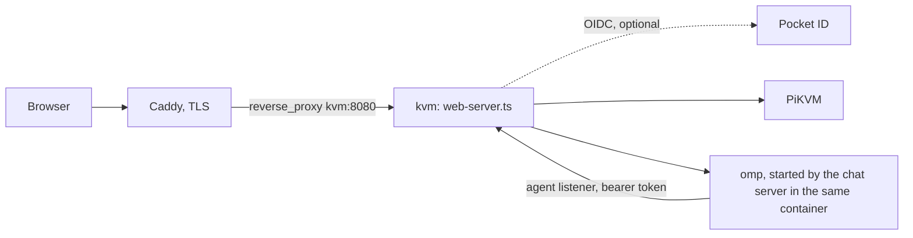

# PiKVM Desktop

PiKVM Desktop is a chat-first workspace for supervised computer use. You connect a PiKVM, choose a model, and ask for an outcome in plain language. The conversation shows the plan, each tool call, screen changes, and approval requests.

The desktop app and the web host run the same server. It serves the app, proxies the PiKVM, and runs the chat server (`packages/chat-server`) and the PiKVM tools (`packages/pikvm-mcp`) in one process. The agent is omp's standalone binary, started once per conversation.

While the agent is working (its state is `working`), the agent has the target's keyboard and mouse. The server refuses a person's input at the PiKVM proxy: the input socket drops input frames, the HTTP input routes answer `423`, and heartbeats still pass. Every page follows the same state, shows the screen as the agent's, and sends nothing. Press Stop to take control back. The server also resets the Pi's held keys when the agent takes the target. When the agent waits for an approval, or has let go, input works again.

In Settings, Notifications you can also be notified when the agent stops for an approval, a question or a form, with words that never say what it wants to do. It is on by default and only reaches devices you set up there.

On Chat and Settings a live copy of the screen floats over the page: a window on a wide screen and a round bubble on a phone. Tap it to open the KVM. Drag it, or throw it and it bounces off the edges. Shift and the arrow keys move it for a keyboard. It only draws the picture the KVM tab already holds. It opens no stream and sends no input.

The model never receives the PiKVM address or credentials. The agent reaches models and the PiKVM only through a separate loopback listener that needs its own bearer token.

## Run it

```bash
yarn install
yarn build
yarn test
yarn start
```

Use Yarn, not npm. `yarn.lock` is the lockfile under version control.

The chat server looks for the agent program in this order:

1. `OMP_BIN`
2. The packaged `resources/omp/omp`
3. The `system.agent.binary` setting, or a name on PATH

Without it, Chat opens and says what is missing. `make package` and `make image` fetch it with `scripts/fetch-omp.mjs`, checked against `deploy/omp.lock`.

## Target keyboard layout

In Settings > Keyboard and mouse, set Keyboard layout to match the target computer: US or UK. The default is US. Agent `type_text` uses this saved setting, not kvmd's default keymap. Changes apply to the next text entry without reconnecting.

For a UK target, choose UK so the hash in `C#` does not arrive as a pound sign. This also selects the correct keys for quotes, `@`, backslash and pipe.

Each `type_text` result contains JSON with the selected layout, kvmd's default keymap and distinct layout-sensitive characters. For each character, it shows the physical key and its known US/UK alternative. An unknown alternative is `null`. The result also reports whether the known kvmd keymap family matches the selected layout.

These checks do not identify the target operating system's active layout. Even matching settings cannot confirm received text, so `outputVerified` is always false. The app does not switch layouts or retry text automatically.

Physical-key commands remain physical keys. For example, `key` with `Shift+3` still produces a pound sign on a UK target. Agent text mapping does not rewrite physical keyboard shortcuts.

## PiKVMs and credentials

On a first run with no PiKVM saved and no server in use, the KVM tab shows a "Welcome to PiKVM" screen in place of the picture. It asks for the PiKVM's name, address, user name and password, and "Use a server instead" asks for a server's address and access token. A save makes the new PiKVM the one in use and reloads the app onto it. A hosted web build, which pins its PiKVM, never shows it.

In the desktop app, open Settings > Connection to add a PiKVM and edit its name, address, user name, and password. Several can be stored. The first one added is the default and the active one; the video, the keyboard and mouse, the agent and the screen watch follow the active one. A hosted web build shows its one PiKVM read-only. Its environment sets it.

- `pikvms.json` in the app's user data folder holds each PiKVM's name, address and user name, which one is the default and which one is active.
- `pikvms-credentials.json` beside it holds the passwords, one per PiKVM, with mode 0600.
- The password is write-only. No API reply or form shows it.
- An older install has one PiKVM in `pikvm.json` and its password in `pikvm-credentials.json` (or `user:pass` inside the address). The app reads it as the first entry, and moves it to the new files the first time you change something in Settings.

The API is `GET` and `PUT /app/api/v1/target`. A host that pins the PiKVM answers the `PUT` with `403`.

## A state server

The desktop app keeps its settings, macros and PiKVM list locally. In Settings you can add a **state server**, another PiKVM Desktop host that holds them instead. While one is in use, this app forwards every request except its own sign-in, PWA, web app files and server switch to that server. The server holds the settings, macros, PiKVM list, chat, agent, screen watch and cursor, and talks to its own PiKVM with its own credentials, so the video, keyboard and mouse run from the server to the PiKVM.

- Adding one opens the server's own sign-in in your browser: you sign in there and press Allow, and the app saves its own revocable device token. You can still paste an access token instead. Revoke a device in the server's Settings > Account.
- The server's address must be `https://`, or `http://` to this machine (`localhost`, `127.x`, `::1`). Anything else is refused, because the access token and the PiKVM passwords travel to it.
- Adding one probes it with the access token (`GET /app/api/v1/state`) and saves it. **Use** probes it again and, when it answers, makes it the one in use. Nothing is copied between servers: while a server is in use, its settings, macros and PiKVM list are the ones this app shows, and this app's own copy is untouched.
- While one is in use, this app serves its own sign-in, PWA, web app files and server switch, and forwards everything else: the API, chat, the agent, the screen watch, the cursor, `/target`, the PiKVM proxy, and the video and HID sockets.
- Only the saved server is kept: at most one. Adding another is refused with 409 until the saved one is removed. Removing it forgets it and its token. This app's own settings, macros and PiKVM list are not changed.
- `servers.json` holds the saved server's address and whether it is in use. Its access token is only in `server-tokens.json`, mode 0600. Neither is returned by the API: `GET /app/api/v1/servers` says `tokenSet`.
- A PiKVM password goes only to the server in use, only over https (or http to loopback), and never comes back in any reply, log or error. The server answers a save with `passwordSet`, never the password.

A host becomes a state server by having an access token: the desktop's `accessToken` setting. The forwarder drops the page's cookies and `Authorization` header and sends the server's own `Authorization: Bearer <token>` instead.

## Packaging

The desktop app is an Electron app. `@electron/packager` writes the Electron tree. The tool that turns the tree into installers depends on the system.

| System | Formats | Tool |
| --- | --- | --- |
| Linux (x64, arm64) | rpm, deb, Arch, AppImage, Flatpak | [pkgsmith](https://github.com/kierandrewett/pkgsmith), from `pkgsmith.star` |
| macOS (arm64, x64) | dmg, zip | electron-builder, from `packaging/electron-builder.yml` |
| Windows (x64) | nsis, msi, zip | electron-builder, from `packaging/electron-builder.yml` |

- The Flatpak format needs `flatpak` on PATH.
- The dmg builds only on macOS.
- Off Windows, wine builds the nsis and zip. The msi builds only on Windows.
- The macOS and Windows installers are unsigned.

```bash
make package                                   # every format for this platform
node scripts/package.mjs --formats rpm,deb     # chosen formats
node scripts/package.mjs --tree-only           # the Electron tree only
```

Output goes to `builds/packages/<platform>-<arch>/`. The script `scripts/package.mjs` builds the app, writes the tree, and adds the web app and omp's binary to `resources/`. A binary that does not match `deploy/omp.lock` stops the build.

Set `PKGSMITH` to the pkgsmith binary if it is not on PATH.

A tree for another platform can be made anywhere, for example with `--platform win32 --arch x64 --tree-only`. The installers need their own platform's tools, so `.github/workflows/package.yml` builds them on a runner for each system.

A push to a branch keeps the packages as workflow artifacts. A pushed tag such as `v1.15.0` also publishes them: the workflow creates a GitHub Release for the tag, attaches every platform's packages, and updates the Flatpak repository.

`make icons` regenerates `packaging/icons` from `src/assets/icon.png`. It needs ImageMagick.

## Updates

The desktop app does not install updates. It looks up the latest GitHub Release a few seconds after launch and every six hours, and shows a system notification when a newer one exists. Settings > About shows the same under "Latest release", with a button that opens the release page.

The Flatpak updates through its own repository, which is on GitHub Pages and signed with its own key. Add it once, then use the normal Flatpak commands:

```bash
flatpak remote-add --user --if-not-exists pikvm-desktop https://kierandrewett.github.io/pikvm-desktop-agentic/pikvm-desktop.flatpakrepo
flatpak install --user pikvm-desktop dev.drewett.PiKVMDesktop
flatpak update
```

A `.flatpak` file from the release page installs without a remote, so `flatpak update` cannot update it. Remove it with `flatpak uninstall dev.drewett.PiKVMDesktop` and install from the repository once. Your settings stay.

The repository is built by `.github/workflows/flatpak-repo.yml` and `scripts/flatpak-repo.sh`. The signing key is the repository secrets `FLATPAK_GPG_PRIVATE_KEY` and `FLATPAK_GPG_KEY_ID`. The public key is `packaging/flatpak-repo.gpg.b64`.

## Web host

`src/web-server.ts` runs the console and the PiKVM proxy without Electron. It serves phones and browsers. There is no terminal. The Chat tab is the only way to reach the agent.

Build the image with:

```bash
make image    # podman build; use IMAGE_TOOL=docker for docker
```

The environment is the whole configuration. The header of `src/web-server.ts` lists every variable. [docs/deploy-web.md](docs/deploy-web.md) covers deployment.

The host signs users in itself, with up to three methods, each switched on by its environment variables and any combination allowed:

| Method | Variables | What it protects |
| --- | --- | --- |
| Access token | `PIKVM_ACCESS_TOKEN` | `Authorization: Bearer <token>` for a remote PiKVM Desktop or a script, on every route the console reaches; the same token typed into the sign-in page. |
| Password | `PIKVM_LOGIN_USER` with `PIKVM_LOGIN_PASSWORD_HASH` (or `PIKVM_LOGIN_PASSWORD`) | The sign-in page, and `Authorization: Basic` for scripts. Make the hash with `node dist/web-server.js --hash-password`. |
| OpenID Connect | `PIKVM_OIDC_ISSUER`, `PIKVM_OIDC_CLIENT_ID`, `PIKVM_OIDC_CLIENT_SECRET`, `PIKVM_OIDC_ALLOWED_GROUPS`, `PIKVM_OIDC_ALLOWED_EMAILS` or `PIKVM_OIDC_ALLOWED_SUBJECTS`, `PIKVM_PUBLIC_URL` | "Sign in with the provider" on the sign-in page: the host is the OIDC client itself, with no proxy. The redirect URI is `<PIKVM_PUBLIC_URL>/app/auth/callback`. An email passes only when the provider says `email_verified: true`. With all three allow lists empty every user is refused. |

The sign-in page and OIDC end in a signed session cookie (HttpOnly, SameSite=Lax, 30 days). A bearer and Basic are judged on their own and never become a cookie. Once any method is set there is no loopback exemption: a peer on the same machine signs in like anyone else. The password, the typed token and Basic are refused over plain http from any peer that is not this machine (`403 Sign in over https.`); the host counts a request as https when `PIKVM_PUBLIC_URL` is https, or, with `PIKVM_TRUST_PROXY=1`, when the proxy says so in `X-Forwarded-Proto`. Failed attempts are slowed per client address with `429` and `Retry-After`.

With no method configured the host binds only to loopback, and refuses any other `HOST`. The host speaks plain http, so put a TLS terminator such as Caddy in front of it for https. See [docs/deploy-web.md](docs/deploy-web.md) for every variable, an example compose file and the Pocket ID client.

The reference deployment:



### Public paths

Browsers fetch these without a session, so the host answers them without sign-in: `/app/login`, `/app/auth`, `/app/auth/callback`, `/app/logout`, `/app/manifest.webmanifest`, `/app/sw.js`, the app icons (`/app/icon.png`, `/app/icon-192.png`, `/app/icon-512.png`, `/app/apple-touch-icon.png`) and the launch images of the installed iPhone app under `/app/splash/`. Without the last, the app starts on a blank screen. Nothing here needs configuring. Everything else under `/app/` needs a session, as does everything the host proxies to the Pi.

### Idle jiggler

The idle jiggler is off unless `PIKVM_JIGGLER=1` sets its first value. After you change it in Settings, the saved value wins.

### Touch screens

On a touch screen, the console docks its controls above the soft keyboard. The bar holds speaker, mic, paste, keyboard, and the more button. Rows of modifier and navigation keys follow.

- Trackpad mode is the default. Drag to move the cursor. Tap to click.
- Two fingers scroll. Pinch zooms on the cursor.
- To drag, hold a finger still until it buzzes, then move. Add a second finger while you drag to move the cursor three times as far.
- A lens at the cursor magnifies what is under it.
- Touch mode points where you tap.

The trackpad uses the Pi's absolute mouse by default. The more menu offers relative mode for targets that need it.

### Installed app

When installed as an app (PWA), the console keeps the screen on while it is open. It reconnects after time in the background. It shows a "Can't reach the KVM" screen when the host is out of reach.

## Adding Executor as the external MCP server

The host serves the agent's tools: `ask`, `todo`, and the PiKVM tools (`mcp__pikvm_*`). Settings cannot add an MCP server. The `agent.mcp` setting refuses writes with a `403` that names the Executor gateway, and the discover and test routes refuse too.

External integrations are meant to reach the agent through one gateway, Executor. To turn it on, add one entry to `packages/chat-server/src/mcp/external.ts`:

Use your own gateway URL:

```ts
export const EXTERNAL_MCP: Readonly<Record<string, McpServer>> = {
    executor: { enabled: true, type: "http", url: "https://executor.example.com/mcp" },
};
```

Then run `yarn build` and restart the host.

The server renders the entry into the agent's `mcp.json` through its credential-holding gateway at `/mcp/s/executor`. The agent process never holds Executor's token.

A test in `packages/chat-server` asserts that the table is empty. Update that test in the same change. Run it with `yarn vitest run`.
