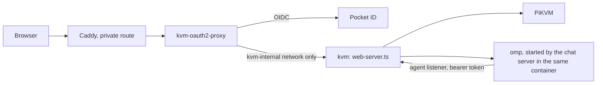

# PiKVM Desktop

A chat-first desktop workspace for supervised computer use. Bring an OAuth- or
API-backed model, connect a managed PiKVM/VNC target, ask for an outcome in
plain language, and watch planning, exact tool calls, screen transitions,
verification, and approvals in one conversation.

The desktop app and the web host run one server. It serves the app, proxies the PiKVM, and runs the chat server
(`packages/chat-server`) and the PiKVM tools (`packages/pikvm-mcp`) inside its own process; the agent itself is omp's
standalone binary, started per conversation.

The model never receives a PiKVM address or credential, a browser token or an approval capability: the agent reaches
models and the PiKVM only through a separate loopback listener that needs its own bearer token, and a consequential
action waits in the conversation for the person to allow it. A person moving the mouse ends the agent's control.

## Development

```bash
yarn install
yarn build
yarn test
yarn start
```

Yarn, not npm: `yarn.lock` is the lockfile under version control, and a stray
`package-lock.json` from an `npm install` is how the two drift apart.

The agent program is found through `OMP_BIN`, the packaged `resources/omp/`, or PATH. Without it Chat opens and
says what is missing. `make package` and `make image` fetch it with `scripts/fetch-omp.mjs` against `deploy/omp.lock`.

## The PiKVM address and credentials

In the desktop app, Settings > Connection edits the PiKVM address, user name and password; the change
applies at once (the proxy and the control core follow it) and the app reloads. A hosted web build keeps
them read-only, pinned by its environment.

`pikvm.json` in the app's user data folder holds the address and user name. The password is in
`pikvm-credentials.json` beside it, mode 0600, written through a temporary file and a rename into a
folder that is 0700 when the app created it. It is write-only: no API reply, log line or error carries it,
and the form never shows it. Installs from before this kept `user:pass` inside the address; that is still
read, never rewritten at startup, and moves to the credentials file the first time you save from Settings.
The API is `GET`/`PUT /app/api/v1/target` (`@pikvm/contracts`); a host that pins the PiKVM answers
`403` to the `PUT`.

## Packaging

The desktop app is an Electron app whose one window loads the embedded server's `/app/`; its only
bridge to the OS is `window.pikvmDesktop` (`packages/contracts/src/desktop.ts`, implemented in
`src/desktop/`). The app is built the normal Electron way (`@electron/packager` writes the Electron tree).
What turns that tree into installers depends on the system:

| System | Formats | Written by | Notes |
| --- | --- | --- | --- |
| Linux (x64, arm64) | rpm, deb, Arch (`.pkg.tar.zst`), AppImage, Flatpak | [pkgsmith](https://github.com/kierandrewett/pkgsmith), from `pkgsmith.star` | needs `flatpak` on PATH for the Flatpak |
| macOS (arm64, x64) | dmg (with the Applications link), zip | [electron-builder](https://www.electron.build), from `packaging/electron-builder.yml` | the dmg only builds on macOS; unsigned, not notarised |
| Windows (x64) | nsis (setup wizard), msi, zip | electron-builder, from `packaging/electron-builder.yml` | Start Menu and desktop shortcuts; unsigned. On Linux wine builds the nsis and zip; the msi (WiX) only builds on Windows |

pkgsmith is for Linux only. electron-builder is run in `--prepackaged` mode over the same tree, so it
does no compiling of its own: it only knows installers (dmg layout, NSIS, WiX) well, which is why it
is used for macOS and Windows rather than a second implementation of them.

```bash
make package          # build, then every format for THIS machine's platform
# -> builds/packages/<platform>-<arch>/
node scripts/package.mjs --formats rpm,deb     # some formats (Linux: pkgsmith's names; macOS: dmg,zip; Windows: nsis,msi,zip)
node scripts/package.mjs --tree-only           # just the Electron tree in builds/
```

`make package` runs `scripts/package.mjs`, which runs the builds, has electron-packager write the Electron tree,
fills its `resources/` (the web app, and omp's standalone binary for the target, fetched by
`scripts/fetch-omp.mjs` and checked against `deploy/omp.lock`; a binary that does not match the pin refuses the
package) and, on Linux, runs `pkgsmith build` over
it; on macOS and Windows `electron-builder --prepackaged` does. Point `PKGSMITH` at the binary if it is
not on PATH; pkgsmith has no release yet, so build it from its repository (`cargo build --release
--workspace`; its plugins must sit beside the binary). The Linux package release is `<commit
count>.<timestamp>` (plus `.dirty`), so a rebuild is always a different package to `dnf` and `apt`. The
macOS and Windows installers are named `pikvm-desktop-<version>-<macos|windows>-<arch>.<ext>` and carry
the plain version.

A tree for another platform can be made anywhere (`--platform win32 --arch x64 --tree-only`), because omp's
binary for any target is one download. The macOS and Windows installers still need their own tools, so
they come from `.github/workflows/package.yml`, which runs the build on a runner of each system and uploads
the packages as artefacts. The icon sizes in `packaging/icons` come from
`make icons`.

## Web host

`src/web-server.ts` runs the console and the PiKVM proxy without Electron, for
phones and browsers. There is no terminal anywhere: the agent is the Chat tab, and the host runs its server
and the agent (omp's standalone binary) itself, so there is no sidecar. One image holds all of it
([docs/deploy-web.md](docs/deploy-web.md) has the variables and the bsociety change).

```bash
make image                           # podman (IMAGE_TOOL=docker for docker) build -f deploy/Dockerfile .
```

The environment is the whole contract; the header of `src/web-server.ts` lists
every variable. The host has no login of its own. Run it behind an
authenticating proxy that is the ONLY route in, and set `PIKVM_AUTH=proxy`;
without that it refuses to bind anything but loopback. Publishing its port
directly would put the KVM on the network with no sign-in.

The bsociety deployment (`/srv/machines/bsociety/kvm/compose.yml`) is the
reference:



Let these public static paths through the authenticating proxy without sign-in
(oauth2-proxy: `--skip-auth-route` or `skip_auth_routes`), because browsers
fetch them without cookies and the installed app needs them before anyone is
signed in:

```
GET=^/app/manifest\.webmanifest$
GET=^/app/sw\.js$
GET=^/app/(icon|icon-192|icon-512|apple-touch-icon)\.png$
```

Everything else under `/app/`, and everything the host proxies to the Pi, stays
behind sign-in. The idle jiggler is off unless `PIKVM_JIGGLER=1` sets its
first value; once it has been changed in Settings (`PATCH /app/api/v1/settings`)
the saved value wins.

On a touch screen the console docks its controls above the soft keyboard, in
the desktop titlebar's style: speaker, mic, paste, keyboard and ⋯ in the bar,
then rows of modifier and navigation keys (Fn and More open F1-F12 and the
common shortcuts). ⋯ opens as a sheet in the bar; it also holds the mouse
buttons and the input settings. Trackpad mode (the default) moves the cursor
by drag and taps click. Holding still for half a second arms the touch: move
to drag with the left button held, or lift to right-click. Quick swipes never
press a button. Two fingers scroll,
pinch zooms on the cursor and the view follows it, and a lens at the cursor
magnifies what is under it. Touch mode points where you tap. The trackpad uses
the Pi's absolute mouse by default; relative is in ⋯ for targets that need it.

Installed as an app (PWA), it keeps the screen on while open, reconnects after
being in the background, and shows a "Can't reach the KVM" screen that
retries by itself when the host is out of reach.

## Adding Executor as the one external MCP server

The agent has two kinds of tools: `ask`, `todo` and the PiKVM tools (`mcp__pikvm_*`), which the host serves itself, and
nothing else. There is no way to add an MCP server in Settings (the `agent.mcp` setting refuses writes with a 403
that names the Executor gateway, and the discover and test routes refuse too). External integrations are meant to
reach the agent through one gateway, Executor (`https://exe.drewett.dev/mcp`), and turning it on is one entry in
`packages/chat-server/src/mcp/external.ts`:

```ts
export const EXTERNAL_MCP: Readonly<Record<string, McpServer>> = {
    executor: { enabled: true, type: "http", url: "https://exe.drewett.dev/mcp" },
};
```

Rebuild (`yarn build`) and restart the host. The server renders the entry into the agent's `mcp.json` through its
credential-holding gateway (`/mcp/s/executor`), so the agent process never holds Executor's token; the sign-in
and per-tool policies of an HTTP MCP server work as they do in `~/dev/chat`. The host's own tests
(`packages/chat-server`, `yarn vitest run`) pin that the table is empty today, so the change also edits the test that
says so.
