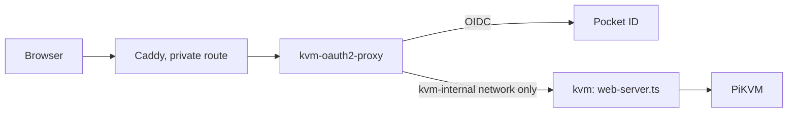

# PiKVM Desktop

A chat-first desktop workspace for supervised computer use. Bring an OAuth- or
API-backed model, connect a managed PiKVM/VNC target, ask for an outcome in
plain language, and watch planning, exact tool calls, screen transitions,
verification, and approvals in one conversation.

The desktop owns two local services:

- the provider-neutral chat and operator harness;
- the machine-control daemon selected at runtime.

The model never receives a VNC address, PiKVM credential, browser token, or
approval capability. Normal Claude MCP compatibility exposes only the five
high-level managed computer controls. The first-party harness—not Claude
Code—plans, selects bounded input, verifies the resulting frame, and handles
recovery. Guarded direct MCP remains available only with the explicit
`--control-mode direct` launcher argument.

## Development

```bash
yarn install
yarn build
yarn test
yarn start
```

Yarn, not npm: `yarn.lock` is the lockfile under version control, and a stray
`package-lock.json` from an `npm install` is how the two drift apart.

`PIKVM_AGENT_DAEMON`, `PIKVM_HARNESS_ORIGIN`, `PIKVM_AGENT_CONFIG`, and
`PIKVM_HARNESS_CONFIG` select local runtime services without hard-coding a
computer endpoint. Use `PIKVM_AGENT_FAKE=1` for target-free development.

The ordinary MCP entrypoint is:

```bash
node dist/mcp-launcher.js \
  --runtime "/path/to/owner-only/harness-runtime.json" \
  --caller-label claude-cli
```

The default launches `harness managed-mcp`. Direct compatibility must be
requested deliberately:

```bash
node dist/mcp-launcher.js \
  --runtime "/path/to/owner-only/harness-runtime.json" \
  --caller-label claude-cli \
  --control-mode direct
```

The runtime handoff is mode `0600`, tied to the live desktop process, and never
contains the browser operator token or daemon approval capability.

## Web host

`src/web-server.ts` runs the console and the PiKVM proxy without Electron, for
phones and browsers. It has no shared terminal and no agent harness.

```bash
make web-bundle                      # builds/web/: Docker context
docker build -t pikvm-web builds/web
```

The environment is the whole contract; the header of `src/web-server.ts` lists
every variable. The host has no login of its own. Run it behind an
authenticating proxy that is the ONLY route in, and set `PIKVM_AUTH=proxy`;
without that it refuses to bind anything but loopback. Publishing its port
directly would put the KVM on the network with no sign-in.

The bsociety deployment (`/srv/machines/bsociety/kvm/compose.yml`) is the
reference:



Let `/_agent/manifest.webmanifest` and `/_agent/icon.png` through without
sign-in: browsers fetch both without cookies. The idle jiggler stays off unless
`PIKVM_JIGGLER=1`.

On a touch screen the console docks its controls above the soft keyboard.
Trackpad mode (the default) moves the cursor by drag, taps click, long-press
right-clicks, pinch zooms and the zoomed view follows the cursor. Touch mode
points where you tap. The trackpad uses the Pi's relative mouse unless the dock
is set to Abs; a mouse, a pen and touch mode always use absolute.
