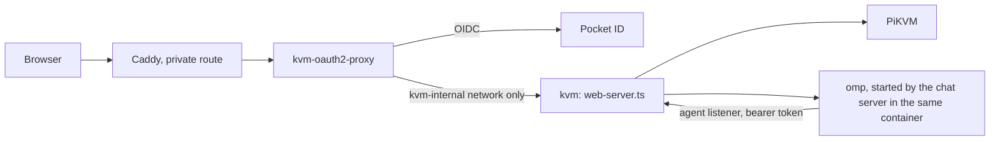

# PiKVM Desktop

PiKVM Desktop is a chat-first workspace for supervised computer use. You connect a PiKVM, choose a model, and ask for an outcome in plain language. The conversation shows the plan, each tool call, screen changes, and approval requests.

The desktop app and the web host run the same server. It serves the app, proxies the PiKVM, and runs the chat server (`packages/chat-server`) and the PiKVM tools (`packages/pikvm-mcp`) in one process. The agent is omp's standalone binary, started once per conversation.

The model never receives the PiKVM address or credentials. The agent reaches models and the PiKVM only through a separate loopback listener that needs its own bearer token.

## Run it

```bash
yarn install
yarn build
yarn test
yarn start
```

Use Yarn, not npm. `yarn.lock` is the lockfile under version control.

The chat server looks for the agent program in this order:

1. `OMP_BIN`
2. The packaged `resources/omp/omp`
3. The `system.agent.binary` setting, or a name on PATH

Without it, Chat opens and says what is missing. `make package` and `make image` fetch it with `scripts/fetch-omp.mjs`, checked against `deploy/omp.lock`.

## PiKVM address and credentials

In the desktop app, open Settings > Connection to edit the address, user name, and password. The change applies at once and the app reloads. A hosted web build shows these values read-only. Its environment sets them.

- `pikvm.json` in the app's user data folder holds the address and user name.
- `pikvm-credentials.json` beside it holds the password, with mode 0600.
- The password is write-only. No API reply or form shows it.
- An older install may keep `user:pass` inside the address. The app still reads it and moves it to the credentials file the first time you save from Settings.

The API is `GET` and `PUT /app/api/v1/target`. A host that pins the PiKVM answers the `PUT` with `403`.

## Packaging

The desktop app is an Electron app. `@electron/packager` writes the Electron tree. The tool that turns the tree into installers depends on the system.

| System | Formats | Tool |
| --- | --- | --- |
| Linux (x64, arm64) | rpm, deb, Arch, AppImage, Flatpak | [pkgsmith](https://github.com/kierandrewett/pkgsmith), from `pkgsmith.star` |
| macOS (arm64, x64) | dmg, zip | electron-builder, from `packaging/electron-builder.yml` |
| Windows (x64) | nsis, msi, zip | electron-builder, from `packaging/electron-builder.yml` |

- The Flatpak format needs `flatpak` on PATH.
- The dmg builds only on macOS.
- Off Windows, wine builds the nsis and zip. The msi builds only on Windows.
- The macOS and Windows installers are unsigned.

```bash
make package                                   # every format for this platform
node scripts/package.mjs --formats rpm,deb     # chosen formats
node scripts/package.mjs --tree-only           # the Electron tree only
```

Output goes to `builds/packages/<platform>-<arch>/`. The script `scripts/package.mjs` builds the app, writes the tree, and adds the web app and omp's binary to `resources/`. A binary that does not match `deploy/omp.lock` stops the build.

Set `PKGSMITH` to the pkgsmith binary if it is not on PATH.

A tree for another platform can be made anywhere, for example with `--platform win32 --arch x64 --tree-only`. The installers need their own platform's tools, so `.github/workflows/package.yml` builds them on a runner for each system.

A push to a branch keeps the packages as workflow artifacts. A pushed tag such as `v1.15.0` also publishes them: the workflow creates a GitHub Release for the tag, attaches every platform's packages, and updates the Flatpak repository.

`make icons` regenerates `packaging/icons` from `src/assets/icon.png`. It needs ImageMagick.

## Updates

The desktop app does not install updates. It looks up the latest GitHub Release a few seconds after launch and every six hours, and shows a system notification when a newer one exists. Settings > About shows the same under "Latest release", with a button that opens the release page.

The Flatpak updates through its own repository, which is on GitHub Pages and signed with its own key. Add it once, then use the normal Flatpak commands:

```bash
flatpak remote-add --user --if-not-exists pikvm-desktop https://kierandrewett.github.io/pikvm-desktop-agentic/pikvm-desktop.flatpakrepo
flatpak install --user pikvm-desktop dev.drewett.PiKVMDesktop
flatpak update
```

A `.flatpak` file from the release page installs without a remote, so `flatpak update` cannot update it. Remove it with `flatpak uninstall dev.drewett.PiKVMDesktop` and install from the repository once. Your settings stay.

The repository is built by `.github/workflows/flatpak-repo.yml` and `scripts/flatpak-repo.sh`. The signing key is the repository secrets `FLATPAK_GPG_PRIVATE_KEY` and `FLATPAK_GPG_KEY_ID`. The public key is `packaging/flatpak-repo.gpg.b64`.

## Web host

`src/web-server.ts` runs the console and the PiKVM proxy without Electron. It serves phones and browsers. There is no terminal. The Chat tab is the only way to reach the agent.

Build the image with:

```bash
make image    # podman build; use IMAGE_TOOL=docker for docker
```

The environment is the whole configuration. The header of `src/web-server.ts` lists every variable. [docs/deploy-web.md](docs/deploy-web.md) covers deployment.

The host has no login of its own. Put an authenticating proxy in front of it, make that proxy the only route in, and set `PIKVM_AUTH=proxy`. Without that setting, the host binds only to loopback. Never publish its port directly.

This layout is the reference deployment:



### Public paths

Browsers fetch these paths without cookies. Let them through the proxy without sign-in. In oauth2-proxy, use `--skip-auth-route` or `skip_auth_routes`.

```
GET=^/app/manifest\.webmanifest$
GET=^/app/sw\.js$
GET=^/app/(icon|icon-192|icon-512|apple-touch-icon)\.png$
GET=^/app/splash/apple-splash-(portrait|landscape)-[23]x-[0-9]+x[0-9]+\.png$
```

The last rule serves the launch image of the installed iPhone app. Without it, the app starts on a blank screen.

Everything else under `/app/` stays behind sign-in, as does everything the host proxies to the Pi.

### Idle jiggler

The idle jiggler is off unless `PIKVM_JIGGLER=1` sets its first value. After you change it in Settings, the saved value wins.

### Touch screens

On a touch screen, the console docks its controls above the soft keyboard. The bar holds speaker, mic, paste, keyboard, and the more button. Rows of modifier and navigation keys follow.

- Trackpad mode is the default. Drag to move the cursor. Tap to click.
- Two fingers scroll. Pinch zooms on the cursor.
- A lens at the cursor magnifies what is under it.
- Touch mode points where you tap.

The trackpad uses the Pi's absolute mouse by default. The more menu offers relative mode for targets that need it.

### Installed app

When installed as an app (PWA), the console keeps the screen on while it is open. It reconnects after time in the background. It shows a "Can't reach the KVM" screen when the host is out of reach.

## Adding Executor as the external MCP server

The host serves the agent's tools: `ask`, `todo`, and the PiKVM tools (`mcp__pikvm_*`). Settings cannot add an MCP server. The `agent.mcp` setting refuses writes with a `403` that names the Executor gateway, and the discover and test routes refuse too.

External integrations are meant to reach the agent through one gateway, Executor. To turn it on, add one entry to `packages/chat-server/src/mcp/external.ts`:

Use your own gateway URL:

```ts
export const EXTERNAL_MCP: Readonly<Record<string, McpServer>> = {
    executor: { enabled: true, type: "http", url: "https://executor.example.com/mcp" },
};
```

Then run `yarn build` and restart the host.

The server renders the entry into the agent's `mcp.json` through its credential-holding gateway at `/mcp/s/executor`. The agent process never holds Executor's token.

A test in `packages/chat-server` asserts that the table is empty. Update that test in the same change. Run it with `yarn vitest run`.
