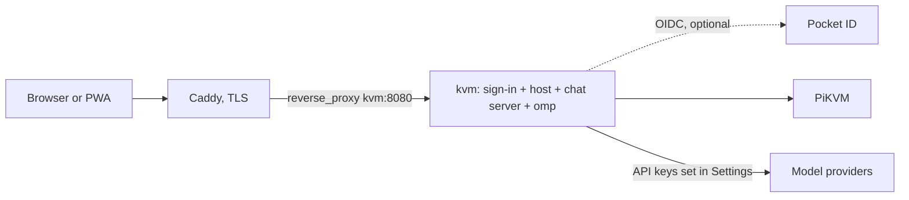
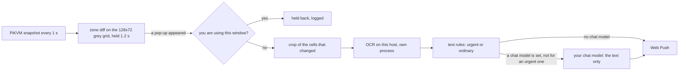

# Deploying the web host

One image, `deploy/Dockerfile`, holds everything: the web host (`src/web-server.ts`), which serves the app and
proxies the PiKVM, the chat server it runs in the same process, and omp's standalone binary, which is the agent.
There is no sidecar, no Python and no Bun. The agent is spawned by the host, once per active conversation, and
reaches the PiKVM only through the host's own tools.



## The image

```sh
make image                       # podman build --format docker -f deploy/Dockerfile -t pikvm-kvm:local .
make image IMAGE_TOOL=docker     # or docker; IMAGE=name:tag renames the result
```

Built from the repository root, in three stages:

1. **omp.** `scripts/fetch-omp.mjs` downloads the release asset for the image's architecture (`linux-x64` or
   `linux-arm64`, by `TARGETARCH`) and checks it against the sha256 in `deploy/omp.lock`. A mismatch fails the build.
2. **build.** `yarn install --immutable`, `yarn build` and the web app's build.
3. **runtime** (`node:22-bookworm-slim`). `tini`, `ca-certificates`, `sharp` (the build argument `SHARP_VERSION`,
   for screenshot resize and crop; a native addon with a prebuilt binary, so the image is glibc and not alpine),
   `dist/`, `apps/web/dist` and the binary at `/opt/omp/omp`.

It runs as uid 10001, writes only `/data` and `/tmp`, needs no capability, and has a healthcheck on `/app/login`.
The recommended posture is:

```yaml
read_only: true
tmpfs: [/tmp]
cap_drop: [ALL]
security_opt: ["no-new-privileges:true"]
```

podman builds OCI images by default, and OCI has no `HEALTHCHECK`; `make image` passes `--format docker` for podman.

### Environment

| Variable | Required | Meaning |
| --- | --- | --- |
| `PIKVM_URL` | yes | The PiKVM, e.g. `https://pikvm.example.ts.net`. |
| `PIKVM_USER` | no | kvmd user (default `admin`). |
| `PIKVM_PASSWORD` | yes | kvmd password. Held by the host only; never in the agent's environment, files or prompt. |
| `PIKVM_ACCESS_TOKEN` | one method needed | Sign-in method 1, the access token: `Authorization: Bearer <token>` for a remote PiKVM Desktop or a script, and a token field on the sign-in page. A wrong bearer gets 401; unset, every bearer is refused. |
| `PIKVM_SYNC_ALLOW_HTTP` | no | `1` accepts a bearer over plain http from a non-loopback peer. Default: refused, so a token never crosses a network in clear. |
| `PIKVM_LOGIN_USER`, `PIKVM_LOGIN_PASSWORD_HASH` or `PIKVM_LOGIN_PASSWORD` | one method needed | Sign-in method 2, a password: the user name and an scrypt hash (`node dist/web-server.js --hash-password`) or the plain password. |
| `PIKVM_OIDC_ISSUER`, `PIKVM_OIDC_CLIENT_ID`, `PIKVM_OIDC_CLIENT_SECRET`, `PIKVM_OIDC_SCOPES`, `PIKVM_OIDC_ALLOWED_GROUPS`, `PIKVM_OIDC_ALLOWED_EMAILS`, `PIKVM_OIDC_ALLOWED_SUBJECTS` | one method needed | Sign-in method 3, OpenID Connect, with `PIKVM_PUBLIC_URL`. Every variable is explained under "Running it". |
| `PIKVM_PUBLIC_URL` | for OIDC | The https origin users see, e.g. `https://kvm.example.com`; the OIDC redirect URI is `<PIKVM_PUBLIC_URL>/app/auth/callback`. An https value also marks the session cookie `Secure` and lets the password and token forms through. |
| `PIKVM_TRUST_PROXY` | no | `1`: believe `X-Forwarded-Proto` and the last `X-Forwarded-For` hop from the reverse proxy in front. Unset: those headers are ignored. |
| `PIKVM_SESSION_SECRET` | no | At least 32 characters, the key that signs session cookies. Unset: a random one is kept in `<PIKVM_DATA_DIR>/session-secret`. |
| `PORT` | no | Listen port (default `8080`). |
| `PIKVM_DATA_DIR` | no | The data volume (image default `/data`). |
| `PIKVM_KEYBOARD_LAYOUT`, `PIKVM_JIGGLER` | no | As before. |
| `OMP_BIN` | no | The agent binary (image default `/opt/omp/omp`). |
| `PIKVM_WATCH_INTERVAL_MS` | no | How often the watch looks at the screen (default `1000`; values under `1000` are raised to `1000`). |
| `PIKVM_WATCH_SETTLE_MS` | no | How long a pop-up must stay before it counts (default `1200`). |
| `PIKVM_WATCH_MIN_GAP_SEC` | no | At most one check per watch in this many seconds (default `4`). |
| `PIKVM_WATCH_DAILY_CAP` | no | At most this many checks per watch in 24 hours (default `500`). |
| `PIKVM_OCR_MODELS`, `PIKVM_OCR_WORKER`, `PIKVM_OCR_THREADS` | no | The OCR that reads pop-ups: the models directory (image default `/opt/ocr/models`), its worker script (default `ocr-worker.js` beside the bundle) and onnxruntime's threads in it (default `2`). |
| `PIKVM_WATCH_LOG_TEXT` | no | `1` puts a notification's words (title and body) in `checks.jsonl`. Off by default: the log then says what kind of pop-up it was and how long it was, not what it said. |
| `PIKVM_PUSH_SUBJECT` | no | The VAPID contact (`mailto:` or `https:`) for a push whose device did not report the address it was opened at. Normally unset: each device reports it. |
| `PIKVM_PUSH_ALLOW_LOCAL` | no | `1` accepts push subscriptions on any address, loopback and plain http included. For tests and local runs only: left off, only the push services browsers use are accepted. |

`PIKVM_HARNESS_URL`, `PIKVM_HARNESS_TOKEN`, `PIKVM_DESKTOP_URL` and `PIKVM_DESKTOP_TOKEN` are gone: there is no
sidecar to point at.

The data volume holds, and is the only thing that needs backing up:

| Path | What |
| --- | --- |
| `settings.json` | The host's settings. |
| `chat/` | The chat database, per-conversation files, the agent's `HOME`, and provider keys entered in Settings (mode 0600, write-only from the browser). |
| `push-vapid.json` | The server's Web Push key pair, made once on first use (mode 0600). **Back it up with the volume and never delete it**: a new pair orphans every device's subscription. |
| `chat/users/<id>/watch/` | One user's screen watch (directory 0700, files 0600): `settings.json` (on or off, the rule, the corner; fields of older versions are ignored), `checks.jsonl` (one line per check, rotated at 512 KB to `checks.jsonl.1`) and `push-subscriptions.json` (the devices). Today there is one user, `operator`. |

Model providers are set in the app: Settings, then Providers, then add a base URL and key. Sign-in with a provider
account (the old Claude and Codex CLI flows) is not part of this image.

## Screen watch (notifications to the installed app)

The server can watch one corner of the PiKVM's screen by itself, with no browser open, and send a notification to the installed
home-screen app when a pop-up appears there (a toast: Windows shows them at the bottom right and keeps them about 5 s). It is per user
and off until switched on in Settings, Notifications. It is one poller on the PiKVM, shared by everyone who has theirs on, and it runs
only while at least one person does. There is one mode: the settings are on or off, **Where pop-ups appear** (bottom right, top right,
bottom left, top left; stored as a rectangle of the frame in fractions, `alertZone`, default x 0.62 to 1, y 0.55 to 1, so a custom rectangle
can be offered later) and an optional rule in the person's own words.



1. **The zone diff (free).** Every `PIKVM_WATCH_INTERVAL_MS` (**1 s**) the host takes `/api/streamer/snapshot`, reduces it to a 128 x 72
   grey grid (a cell is 15 px of a 1920 px frame) and compares the zone's cells with the zone as it was: 49 x 33 = 1617 cells for the
   default. A cell has changed when its grey level moved by at least 10 of 255; the zone has changed when **1.5 %** of its cells did (25
   cells). Calibrated on 1920 x 1080 frames drawn for the run (`docs/e2e/2026-11-05-fast-alerts.md`): a blinking caret is 0.12 %, the
   taskbar clock changing 0 %, the mouse pointer 0.19 to 0.25 %, a tray icon 0.31 %, a turning spinner up to 0.43 %, JPEG re-encoding or
   codec noise 0 %; a dark-card toast is 8.5 to 12.7 %, a light-card toast 10.3 to 17.2 %, a toast with two buttons 10.6 to 15.8 %, the
   weakest toast tried (one dark line on a near-identical dark desktop) 7.2 %. A change counts as a pop-up once it has **held 1.2 s**
   (`PIKVM_WATCH_SETTLE_MS`; a toast slides in over about 0.3 s). It is **not dropped if it goes away**: it is read from the look that
   confirmed it, or, if it had gone again by then, from the last look that saw it. More than half the zone changing is a window or the
   desktop, not a pop-up: logged as skipped and not read. When a change is pending the host makes one extra look at the moment it will
   have held long enough, so the wait is the settle time and not that plus a look. Nothing else runs unless this fires.
2. **A crop of what changed.** The cells that changed, plus two cells of margin (about 30 px), inside the zone: usually about 420 x 200 px
   at 1080p. Text the OCR finds outside the changed cells is the window behind the pop-up and is left out.
3. **OCR on this host.** PP-OCRv4 mobile (PaddleOCR's detector and recogniser as ONNX) through onnxruntime-node, in a forked process of its
   own (`dist/ocr-worker.js`), warm once the watch is on, one read at a time, 4 s limit (then it is killed and restarted). It opens no
   socket. Chosen by benchmark (`docs/e2e/2026-11-05-fast-alerts-ocr.md`): on the Xeon E5-2680 v4 the image runs on, under load 14,
   **165 ms median (p95 245) for the crop, 771 ms (p95 981) if the whole zone were read**, every word found; tesseract and tesseract.js were
   no faster on the crop and read dark cards badly. **onnxruntime's telemetry is switched off.** The Linux build of onnxruntime-node
   includes Microsoft's 1DS telemetry (endpoint `mobile.events.data.microsoft.com`). The host forces `ORT_DISABLE_TELEMETRY=1` in the OCR
   worker's environment (`ocr-engine.ts` sets it after the host's own environment, so a value in it cannot turn it back on;
   `ocr-worker.ts` sets it again; the image's `ENV` has it too), and a unit test holds this. If the OCR times out, fails or reads fewer than 3
   words, the check is logged with the reason and nothing is sent.
4. **Text rules** (`src/server/watch/toast-rules.ts`, deterministic). A pop-up that says someone is calling (incoming call, is calling,
   calling you, ringing, wants to call, or Accept/Answer with Decline/Reject/Ignore) is pushed as **"Incoming call: <who>"** with Web Push
   `Urgency: high`, a **60 s** TTL, and a tag per caller. A pop-up that names its app is pushed under that name, as "sender: first line"
   (at most 300 characters; the phone cuts it to what fits); any other shows its lines. Urgency normal, a 5 minute TTL and a tag of its
   text. Buttons, close glyphs and clock times are dropped; fewer than 3 words is nothing. The **same pop-up text inside 30 s is notified
   once**.
5. **The notification's words, from your chat model (optional).** If the app has a chat model configured (Settings, Models: the Small
   tasks role, else Fast, else the default model, on whatever provider it names, through the chat server's own stored credential and
   API type; no provider is built in here), the OCR **text** (never the picture) goes to it in **one small request** with a tight prompt:
   one sentence, at most 140 characters, who and what and what is asked, fix words the OCR ran together, never add what the text does
   not say. The sentence becomes the body; the title stays the rules' title. **With a rule** (Settings, "What to tell me about") the rule
   goes in the same request and the model answers either the sentence or the exact word `SKIP`, which means no notification. **Without
   a rule** every pop-up is notified. A hard **2.5 s** timeout (the request is aborted); on a timeout, an error, an empty answer or one over
   140 characters the rules' own text is sent (with a rule too: a rule that could not be applied is not a reason to miss a pop-up) and the
   log says `summary skipped: <reason>` (a reason, never text). **A call never waits for the model** and is never asked about. With **no chat
   model configured there is no network call at all**: the notification is the text as read, and a rule cannot be applied (the page says
   so). A model that cannot be called (no key, an API type the chat server has no client for) counts as none.
6. **Held back while you are using the window.** Every notification, a call too, is suppressed while the person is already at the screen: a page of
   the app has **focus** (visible and `document.hasFocus()`, the existing `useInBackground`) **and** saw **real** input within the last
   **20 s** (`USER_ACTIVE_WINDOW_MS`): any real key press, or a significant pointer movement (about **40 CSS px** of path, forgotten after 1 s
   without movement, so a nudge, a bump or drift does not count; a finger on the screen counts at once, since touch is how a phone is used; a mouse
   click without movement does not). Only **real** input counts: trusted DOM events (`isTrusted`) on the page. The HID the app itself sends
   (the jiggler's nudges, the computer-use agent, macros, replays) never counts, and the host infers nothing from HID traffic. The check is made
   **first** (a pop-up that appears while you are at the screen is not even read), **again before the chat model is asked** and **again just
   before the push**, so no model request, no push and no cost when it holds. The check log gets its own outcome, `held`, "you are using
   this window", with no pop-up text, and a held pop-up is not marked as notified, so the same one is sent when you have left. The page
   (`apps/web/src/notify/presence.ts`, mounted in the shell for the hosted app, the phone app and the desktop shell alike) reports to
   `POST /app/api/v1/watch/presence` (the same sign-in as the other watch routes) a body of `{clientId, focused, keyboardAgoMs,
   pointerAgoMs}`: a random id per page, a focus flag and two **ages** in ms (null for none; ages, not timestamps, so the clocks of the page
   and the host never meet). It reports when the person becomes active, then every **5 s** while the page is focused and the person active, once when focus is lost or
   the person goes idle, and otherwise not at all. The host keeps one record per client and forgets a client after **12 s**
   (`PRESENCE_EXPIRY_MS`) without a report, so a closed tab or a crashed app cannot hold notifications back; it holds a notification back if
   ANY client is focused with input inside the 20 s window. Nothing else leaves the page: no key, no coordinate, no text.
7. **The push.** A Web Push (VAPID, encrypted) to every device of that user; a tap opens `/app/`. A push service that answers 404 or 410
   says the device is gone and its subscription is removed.

Signal: while kvmd reports no video source (its snapshot answers 503), nothing is compared: a black screen is not a pop-up. The PiKVM
being unreachable is not a lost signal.

**What leaves the host, said plainly.** The pop-up is read on the host. Only the OCR **text** of a pop-up goes to the chat model the
app already has configured, and only when there is one: the picture never does. With no chat model nothing from the screen goes to any
model service. The notification itself goes to the device's push service, as always.

### What it costs, and the bounds

- **Per check:** the host's CPU (one snapshot a second, 3 ms to turn it into the grey grid on a workstation, and the OCR when a pop-up
  appears) and, with a chat model, one request of about 100 tokens in and 20 out. Tried with three small models on 2026-11-05: about
  $0.00001 per notification, 0.14 to 2.9 s a request (so the 2.5 s limit is real); the cost is on whatever provider the chat model is.
- **Bounds** (per watch, whatever the screen does): at most **one check per 4 s**; a pop-up inside that gap waits, and only the newest one
  is checked when it ends (the ones it replaced are logged as skipped); at most **500 checks in any 24 hours**, counted from the log so a
  restart does not reset it; one check at a time. Two pop-ups 5 s apart both notify.
- **Looking every second:** about 123 KB a second from the Pi (the real Pi's snapshot, measured by hand at 75 to 140 ms each, which
  keeps its snapshot handler busy at most about 14 % of the time; that the Pi serves the streamer's latest JPEG without re-encoding is not
  verified here). The host's CPU stayed at about 1 % of a core in the 30 s idle window measured. The OCR worker holds the models (about
  100 to 250 MB resident) while the watch is on.
- **Image:** `deploy/Dockerfile` installs onnxruntime-node (pruned to this architecture's CPU library) and fetches the models, both pinned in
  `deploy/ocr.lock` (sha256 of the tarball and of each model, the npm integrity of onnxruntime-node); **+80 MB uncompressed** (349 MB
  against 269 MB, measured on the runtime stage's own lines). The image still starts read-only as uid 10001 and the OCR runs with
  `--network none` (checked).

**Measured** (`docs/e2e/2026-11-05-fast-alerts.md`, 10 toasts, fake PiKVM, fake push service on loopback, the real host and OCR on a
workstation, no chat model): **toast to notification at the push service 1.8 s median (1.4 to 1.9 s)**; of that, waiting for the next
look about 0.45 s (0.1 to 0.5 s here, up to 1 s in general), the 1.2 s hold, crop and OCR about 0.1 s (the OCR read itself 90 ms median here), the push send a few ms (loopback). **Not measured**: the push service on a
real network (FCM or Apple add their own delay after the host's send), a real chat model (the fake answers after a scripted delay), a real
Pi, the real Xeon without its other load.

### The log: why it fired or did not

`chat/users/<id>/watch/checks.jsonl`, one JSON object per line, also shown (newest first) under Settings, Notifications, Recent checks and
at `GET /app/api/v1/watch/checks`:

```json
{"t":1793841911885,"at":"2026-11-05T01:25:11.885Z","kind":"alert","score":0.17,"rule":"","asked":true,"outcome":"pushed",
 "latency":{"firstSeenAt":1793841909159,"capturedAt":1793841910360,"detectedAt":1793841910361,"readAt":1793841910460,
            "summarisedAt":1793841910810,"pushedAt":1793841910815,"totalMs":455,"sinceFirstSeenMs":1656},
 "read":{"ms":124,"chars":76,"words":13,"lines":4},"summary":{"used":true,"ms":350},
 "push":{"sent":1,"removed":0,"failed":0},
 "notified":{"kind":"email","tag":"pikvm-alert-6c58e9e4","urgency":"normal","ttlSec":300,"titleChars":7,"bodyChars":59}}
```

`kind` is `alert` (a pop-up) or `test`; `outcome` is `pushed`, `held` (you were using the window), `no` (the rule said it is not what was asked about), `skipped` (nothing was
sent, `reason` says why: replaced by a newer pop-up, daily cap, the same text a moment ago, too little text, a whole-corner change) or
`error` (`reason` says what failed: the OCR, the push). `asked` is what the daily cap counts: a pop-up that was read. `latency` is epoch ms:
`capturedAt` is when the snapshot that was read was requested (the Pi's own capture is inside it), `totalMs` is capture to push and
`sinceFirstSeenMs` is first sight to push. **The log never holds the screen's words**, only lengths and a kind, unless the host runs
with `PIKVM_WATCH_LOG_TEXT=1`.

### Notifications on the iPhone

Web Push works on iOS 16.4 and later **only for the app added to the Home Screen and opened from its icon**, never in a Safari
tab. Add it (Safari, Share, Add to Home Screen), open it from the icon, go to Settings, Notifications and switch it on: the
permission prompt comes from that tap. An app added before this feature existed does not need adding again; open it once so the
new worker (`/app/sw.js`) installs. If the page says notifications are blocked, turn them on in the iPhone's Settings,
Notifications, PiKVM. Nothing new is public: the worker was already a public path, and the push reaches it from Apple, not
through the host's sign-in. The host must be able to reach the push services (`web.push.apple.com`,
`fcm.googleapis.com`) over https.

### Switching it off

- Settings, Notifications, switch off: the poller stops at once if nobody else has it on, and the PiKVM is no longer asked for
  snapshots. Remove this device (same page) forgets a device.
- Without a browser: set `"enabled": false` in `chat/users/<id>/watch/settings.json` and restart the container, or delete
  `push-subscriptions.json` to stop the notifications and keep the watch's log.
- To stop sending pop-up text to a model: remove the chat model (Settings, Models). Nothing is asked of any model without one.

## Running it

The host signs users in itself. There is no proxy or identity gateway to run in front of it, and none is needed for sign-in. A TLS
reverse proxy (Caddy, below) is still how you get https, and the host needs https for passwords and tokens to travel (see
"Where a secret may travel").

With no method configured the host binds only to loopback and refuses any other `HOST` with a message naming the three
groups below. The image sets `HOST=0.0.0.0`, so a container needs at least one method to start. Configure any combination.

### The three ways in

**1. Access token.** Set `PIKVM_ACCESS_TOKEN` to a long random string (`openssl rand -hex 32`).

- A remote PiKVM Desktop or a script sends `Authorization: Bearer <token>` on every route the console reaches. The host accepts
  it only with that exact token and answers 401 otherwise. No `?token=` is read; a request carrying an `Origin` that is not this
  host's own is refused (a browser page must never ride the token); plain http from a non-loopback peer is refused unless
  `PIKVM_SYNC_ALLOW_HTTP=1` (or the request is https, see below).
- The sign-in page also has a token field: type the same token and the host sets a session cookie.
- A bearer is never turned into a cookie, and a cookie is never accepted as a bearer.

**2. Password.** Set `PIKVM_LOGIN_USER` and a hash of the password:

```sh
docker run --rm -it pikvm-kvm:<tag> node dist/web-server.js --hash-password   # asks for the password without echoing it
printf '%s' "$PASSWORD" | docker run --rm -i pikvm-kvm:<tag> node dist/web-server.js --hash-password
```

It prints one line, `scrypt$N$r$p$salt$hash`, and nothing else: that is `PIKVM_LOGIN_PASSWORD_HASH`. In a `.env` file wrap it in
single quotes so compose leaves the `$` alone; written in the compose file itself, each `$` is `$$`. The host accepts N of 16384 or
more. `PIKVM_LOGIN_PASSWORD` takes the password itself instead; it works, but a
hash is better because the environment is easy to leak. Set one of the two.

- The sign-in page has a user name and password form. Scripts can use `Authorization: Basic` with the same credential.
- The user name and the password are each compared in constant time, and the password is always checked (against a dummy hash when
  the user is unknown), so neither how long a refusal takes nor its wording says which half was wrong: the page says
  "That did not work."
- Basic is judged by these rules only. A bearer is not a password and a password is not a bearer.

**3. OpenID Connect.** The host is the relying party of any OIDC provider (Pocket ID, Keycloak, Authentik, ...), directly. No
oauth2-proxy.

| Variable | Meaning |
| --- | --- |
| `PIKVM_OIDC_ISSUER` | The provider's issuer URL, e.g. `https://id.example.com`. https only (plain http is accepted only to loopback, for tests). The host reads `<issuer>/.well-known/openid-configuration`. |
| `PIKVM_OIDC_CLIENT_ID` | The client id. |
| `PIKVM_OIDC_CLIENT_SECRET` | The client secret. Unset: a public client, protected by PKCE alone. |
| `PIKVM_OIDC_SCOPES` | Default `openid email profile groups`. |
| `PIKVM_OIDC_ALLOWED_GROUPS` | Comma list. A user passes if their `groups` claim holds any of them. |
| `PIKVM_OIDC_ALLOWED_EMAILS` | Comma list, compared case-insensitively. A user passes if their `email` is in it **and** the id_token says `email_verified: true`; a missing claim, `false` or the string `"true"` does not count. |
| `PIKVM_OIDC_ALLOWED_SUBJECTS` | Comma list of `sub` values, exact and case-sensitive, for a provider that sends neither groups nor a verified email. |
| `PIKVM_PUBLIC_URL` | The https origin users see, e.g. `https://kvm.example.com`. Required. The redirect URI is `<PIKVM_PUBLIC_URL>/app/auth/callback`. |

A user passes with any one of the three rules. With all three lists empty **every user the provider signs in is refused**: the host says so at startup.

The flow is authorization code with PKCE (S256), `state` and `nonce`, which a short-lived signed HttpOnly cookie ties to the browser
that started it. The id_token is verified with `jose`: its signature against the issuer's JWKS (cached, fetched again for an unknown
key id at most every 30 seconds), the algorithm (RS256, ES256 or EdDSA only; `none` and HS256 are refused), `iss`, `aud` (your
client id), `exp` and `nbf` (60 seconds of skew), and the `nonce`. Only then do the allow rules run. Groups and email are read
from the id_token, so the provider must put them there (Pocket ID does when the `groups` and `email` scopes are requested).

In **Pocket ID**, create an OIDC client with the callback URL `<PIKVM_PUBLIC_URL>/app/auth/callback` (for example
`https://kvm.example.com/app/auth/callback`), give the client to a user group, and name that group in
`PIKVM_OIDC_ALLOWED_GROUPS`. The sign-in page then shows "Sign in with id.example.com".

### Sessions

The form methods and OIDC end in a signed cookie (`__pikvm_session`: HMAC-SHA256, HttpOnly, SameSite=Lax, Path=/). It holds the
method, the subject and its expiry, never a secret. It lasts 30 days and is renewed when a request finds it more than a day old.
It stops working when the token, the password, or the OIDC issuer, client or allow lists change. `GET /app/api/v1/session` tells the app who it is signed in as (`signIn`, `method`, `subject`, `canSignOut`; never a secret); only a cookie session can be signed out. `/app/logout` clears the cookie
in the browser; the cookie itself is stateless, so a copy of it stays valid until its expiry unless you change the secret or the
credential.

The key is `PIKVM_SESSION_SECRET` (at least 32 characters). Unset, the host makes 32 random bytes once and keeps them in
`<PIKVM_DATA_DIR>/session-secret` (mode 0600, written atomically), so sessions survive a restart and a new image on the same volume.
Deleting that file signs everyone out.

WebSocket upgrades use the same cookie and keep the chat socket's same-origin check. The sign-in form POST must come from a page of
this host (a foreign `Origin`, or `Sec-Fetch-Site: cross-site`, is refused). The return path after sign-in (`next`) must be a
relative path starting with a single `/`; anything else goes to `/app/`.

### Where a secret may travel

The password form, the token form and `Authorization: Basic` are refused with `403 Sign in over https.` over plain http from any
peer that is not this machine. There is no setting that turns this off. The host reads a request as https when
`PIKVM_PUBLIC_URL` is an https URL, or, only with `PIKVM_TRUST_PROXY=1`, when the proxy's last `X-Forwarded-Proto` says `https`
(a trusted `X-Forwarded-Proto: http` is refused even from a local peer). A bearer follows the same test, and
`PIKVM_SYNC_ALLOW_HTTP=1` is the one switch that lets a bearer through plain http from a remote peer.

`PIKVM_TRUST_PROXY=1` also makes the host read `X-Forwarded-For` (its last entry, the hop the proxy appended) as the client
address for the rate limit, and marks the cookie `Secure` from `X-Forwarded-Proto`. Leave it unset unless a proxy you control is the
only thing that can reach the port: anyone who can reach the port directly could forge those headers. Unset, they are ignored and the
socket's own address is used. The session cookie is also `Secure` whenever `PIKVM_PUBLIC_URL` is https.

### Failed attempts

Failed sign-ins (the form, Basic, a wrong bearer) are counted per client address. The first three are free; each one after that
doubles the wait before that address may try again (1 s, 2 s, 4 s, up to 15 minutes). While it waits every attempt, the right
password included, gets `429` with `Retry-After`. A success clears the address. Sixty failures from all addresses within a minute
make every attempt wait for the minute to pass. A session already signed in is never slowed. The submitted password and token are
never logged: a refusal logs its kind and the address only.

### Using this host as a server

A remote PiKVM Desktop (or a CLI) can use this host as its server: give it the host's URL and `PIKVM_ACCESS_TOKEN` as its bearer
token. The remote sends `Authorization: Bearer <token>`, which the host judges by the bearer rules alone: valid, or refused 401. It
does not fall back to a cookie or to Basic, and it never sets a cookie. Serve the host over https and leave `PIKVM_SYNC_ALLOW_HTTP`
unset. With `PIKVM_ACCESS_TOKEN` unset every bearer is refused.

### A compose file for the host

No proxy and no oauth2 service: the host and its data. Set whichever methods you want; this one uses a password and Pocket ID.

```yaml
services:
    kvm:
        image: pikvm-kvm:<tag>              # built with `make image`, see above
        container_name: kvm
        restart: unless-stopped
        environment:
            PIKVM_URL: https://pikvm.example.ts.net
            PIKVM_USER: admin
            PIKVM_PASSWORD: ${PIKVM_PASSWORD:?set it in .env}
            PIKVM_PUBLIC_URL: https://kvm.example.com
            PIKVM_TRUST_PROXY: "1"          # Caddy below is the only thing that reaches the port
            # 1. the access token, for the desktop app's server link and scripts
            PIKVM_ACCESS_TOKEN: ${KVM_ACCESS_TOKEN:?openssl rand -hex 32}
            # 2. a password (use $$ for each $ of the hash in a compose file)
            PIKVM_LOGIN_USER: kieran
            PIKVM_LOGIN_PASSWORD_HASH: ${KVM_LOGIN_PASSWORD_HASH:?node dist/web-server.js --hash-password}
            # 3. OpenID Connect (Pocket ID): redirect URI https://kvm.example.com/app/auth/callback
            PIKVM_OIDC_ISSUER: https://id.example.com
            PIKVM_OIDC_CLIENT_ID: ${KVM_OIDC_CLIENT_ID:?}
            PIKVM_OIDC_CLIENT_SECRET: ${KVM_OIDC_CLIENT_SECRET:?}
            PIKVM_OIDC_ALLOWED_GROUPS: kvm
            PIKVM_KEYBOARD_LAYOUT: us
            PORT: "8080"
        volumes:
            - /path/to/kvm-data:/data       # the only thing to back up
        networks:
            - web                           # shared with Caddy; no port is published
        read_only: true
        tmpfs:
            - /tmp
        cap_drop:
            - ALL
        security_opt:
            - no-new-privileges:true

networks:
    web:
        external: true                      # the network your Caddy container is on
```

Caddy, on the same network, terminates TLS and needs one line for the site:

```
kvm.example.com {
    reverse_proxy kvm:8080
}
```

Caddy keeps the original `Host` and adds `X-Forwarded-For` and `X-Forwarded-Proto`, which is what `PIKVM_TRUST_PROXY=1` reads. Nothing
needs to be skipped or let through for sign-in: the host answers its own public paths (`/app/login`, `/app/auth`,
`/app/auth/callback`, the web manifest, the service worker, the icons and the iPhone launch images) without a session and
everything else, Chat's API and sockets included, needs one.

The model provider is called from this container, so the network it is on must have outbound internet: do not declare it `internal`.

**Volume ownership.** The image runs as uid 10001 and writes `/data`, including the `chat/` directory it creates on first
start. Either give that uid the volume (`chown -R 10001:10001 /path/to/kvm-data`), or add `user: "<uid>:<gid>"` to the service
to run as the volume's own owner. With neither, Chat cannot create `/data/chat` and the host stops at start.

### Image delivery: `docker save | ssh docker load`

To run exactly the image the e2e suites ran against, build it in a clean checkout of the tested commit and send the image
itself rather than building on the server:

- the image id is compared after the load, so what is deployed is byte-for-byte what was tested;
- a build on the server needs the toolchain's network at that moment (npm registry, GitHub for omp, Debian mirrors) and a build
  cache there, and a failure leaves a half-built tag. A transfer is one compressed stream of the final image;
- the compose file stops building anything, so nothing on the server drifts from the repository.

```sh
# on the workstation, in a clean checkout of the commit to ship (not a dirty tree)
git status --short                                  # must print nothing
SHA=$(git rev-parse --short=8 HEAD)
make image IMAGE_TOOL=docker IMAGE=pikvm-kvm:$SHA   # fails if omp's sha256 does not match deploy/omp.lock
docker image inspect -f '{{.Id}}' pikvm-kvm:$SHA    # note this id
docker save pikvm-kvm:$SHA | gzip | ssh your-server 'gunzip | docker load'
ssh your-server "docker image inspect -f '{{.Id}}' pikvm-kvm:$SHA"   # must be the same id
```

### Verify

```sh
docker inspect -f '{{.State.Health.Status}} {{.HostConfig.ReadonlyRootfs}} {{.Config.User}}' kvm   # healthy true <user> (after ~15 s)
docker logs kvm 2>&1 | grep -E '\[web\]|\[chat\]'    # "[web] console on http://0.0.0.0:8080/ ..." and "[chat] up, agent /opt/omp/omp"
curl -sI https://kvm.example.com/app/manifest.webmanifest | head -1   # HTTP/2 200 (the signed-out route)
```

Then in a signed-in browser at `https://kvm.example.com/app/`:

1. The KVM tab shows the picture.
2. Settings, Providers: add a model key. The models appear in Chat.
3. Chat: send a message and read the reply. If Chat says it is offline, the socket was refused: it needs the browser's `Origin` to equal the
   `Host` it reaches the container with, or `X-Forwarded-Host`; most proxies keep the original `Host` by default, so this only
   happens if a hop was changed. `docker logs kvm` shows nothing for a refused socket; the browser's network panel shows a 403 on `/app/chat/ws`.
4. Ask the agent to look at the screen. The KVM tab shows "Agent is working", a tap on the picture takes control back, and Stop ends the run.

`docker stats kvm --no-stream` once while a conversation runs: the container holds the host plus one omp process per active conversation,
and the compose file above sets no memory limit.

### Updating and rolling back

Before switching to a new image, keep the way back: tag the running image (`docker tag pikvm-kvm:<old> pikvm-kvm:previous`) and copy the
data volume's small files (`settings.json`, `macros.json`) aside. To roll back, point the compose file at the old tag and
`docker compose up -d kvm`. The data stays compatible between builds that share a data layout; if an older build misreads
`settings.json` after a run of the new one, restore the copy.

## Sandboxing the agent

The agent runs the *computer* profile: its tools are `ask`, `todo` and the PiKVM tools (`mcp__pikvm_*`). It has no
tool that reads files, runs commands or makes requests, and there is no process sandbox in the image (no bubblewrap,
no socat), so no relaxed seccomp on the container that holds the PiKVM password. The residual risk is a bug in omp or
in the tool allow-list, which is the reason to keep the container's default hardening.

## Verified how

`docs/e2e/2026-11-03-image-and-appimage.md` records the image and the Linux AppImage running against a fake kvmd and
a scripted model.

`deploy/e2e/compose.yml` is that stack for a person: `make image`, then `podman compose -f deploy/e2e/compose.yml up`,
then Settings, Providers, base URL `http://fake-model:9000/v1`. `deploy/e2e/up-inspectable.sh up` runs the same image with its
processes and `/data` readable by the invoking user, which `apps/web/e2e/chat.e2e.mjs` needs to inspect the agent (see
`docs/e2e/README.md`).

## The shared cursor

`GET /app/api/v1/cursor` is a server-sent-events stream behind the same gate as the rest of `/app/api` (so nothing new is public
behind the sign-in). Each event is `{x, y, source, seq}`: where the target's pointer is, in kvmd's own units (a fraction of the
screen, so any resolution), who moved it (the page's client id, `agent` for the chat agent's tools, or `socket-N` for a client that
named none) and a sequence number. The host learns positions from each page's `/api/ws` input socket (the page adds `?client=<id>`,
which the host takes off before kvmd sees the URL) and from the agent's mouse tools; at most one event goes out per frame, and a new
stream starts with the current position. A relative-mouse target is tracked from the last known position and clamped (its start is
unknown until the first absolute move or agent move, and the pointer's own acceleration is not known, so it drifts until the next
absolute move); a resolution change keeps an absolute position and keeps the pixel of a relative one. A proxy in front must not
buffer it (the response sends `x-accel-buffering: no`).

## Known limits

- Sizes: see the e2e record. omp's binary is about 277 MB of the image.
- The image is `linux/amd64` or `linux/arm64`; omp has no other Linux build pinned.
- `docker compose` and `podman compose` both work.
- Pop-up watch: the OCR was benchmarked on drawn toasts (Open Sans, flat cards), not on a real Windows PC's Segoe UI toasts; push delivery on a
  real network and a real Pi's snapshot cost under a look a second are not measured (see "Screen watch").
- Screen watch: delivery to a real iPhone is not verified (there is no iPhone here; headless Chrome in the iPhone 13 profile, with its own
  push service, stood in for the installed app in the earlier runs). A pop-up that never stays (a flash under 1.2 s) or keeps changing (a video) is not noticed.
