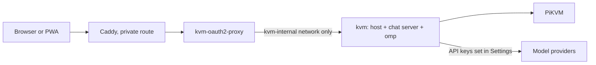
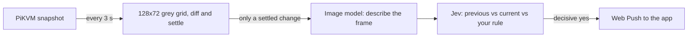

# Deploying the web host

One image, `deploy/Dockerfile`, holds everything: the web host (`src/web-server.ts`), which serves the app and
proxies the PiKVM, the chat server it runs in the same process, and omp's standalone binary, which is the agent.
There is no sidecar, no Python and no Bun. The agent is spawned by the host, once per active conversation, and
reaches the PiKVM only through the host's own tools.



## The image

```sh
make image                       # podman build --format docker -f deploy/Dockerfile -t pikvm-kvm:local .
make image IMAGE_TOOL=docker     # or docker; IMAGE=name:tag renames the result
```

Built from the repository root, in three stages:

1. **omp.** `scripts/fetch-omp.mjs` downloads the release asset for the image's architecture (`linux-x64` or
   `linux-arm64`, by `TARGETARCH`) and checks it against the sha256 in `deploy/omp.lock`. A mismatch fails the build.
2. **build.** `yarn install --immutable`, `yarn build` and the web app's build.
3. **runtime** (`node:22-bookworm-slim`). `tini`, `ca-certificates`, `sharp` (the build argument `SHARP_VERSION`,
   for screenshot resize and crop; a native addon with a prebuilt binary, so the image is glibc and not alpine),
   `dist/`, `apps/web/dist` and the binary at `/opt/omp/omp`.

It runs as uid 10001, writes only `/data` and `/tmp`, needs no capability, and has a healthcheck on `/app/login`.
The default posture is the one bsociety uses:

```yaml
read_only: true
tmpfs: [/tmp]
cap_drop: [ALL]
security_opt: ["no-new-privileges:true"]
```

podman builds OCI images by default, and OCI has no `HEALTHCHECK`; `make image` passes `--format docker` for podman.

### Environment

| Variable | Required | Meaning |
| --- | --- | --- |
| `PIKVM_URL` | yes | The PiKVM, e.g. `https://pikvm.example.ts.net`. |
| `PIKVM_USER` | no | kvmd user (default `admin`). |
| `PIKVM_PASSWORD` | yes | kvmd password. Held by the host only; never in the agent's environment, files or prompt. |
| `PIKVM_AUTH` | for `HOST=0.0.0.0` | `proxy`: an authenticating proxy is in front. The image sets `HOST=0.0.0.0`, so this is required in practice. |
| `PORT` | no | Listen port (default `8080`). |
| `PIKVM_DATA_DIR` | no | The data volume (image default `/data`). |
| `PIKVM_KEYBOARD_LAYOUT`, `PIKVM_JIGGLER` | no | As before. |
| `OMP_BIN` | no | The agent binary (image default `/opt/omp/omp`). |
| `PIKVM_WATCH_INTERVAL_MS` | no | How often the screen watch looks at the screen (default `3000`; values under `2000` are raised to `2000`). |
| `PIKVM_WATCH_SETTLE_MS` | no | How long the screen must stay still after it changed before the change counts (default `6000`). |
| `PIKVM_WATCH_MIN_GAP_SEC` | no | At most one model check per watch in this many seconds (default `60`). |
| `PIKVM_WATCH_DAILY_CAP` | no | At most this many model checks per watch in 24 hours (default `200`). |
| `PIKVM_PUSH_SUBJECT` | no | The VAPID contact (`mailto:` or `https:`) for a push whose device did not report the address it was opened at. Normally unset: each device reports it. |
| `PIKVM_PUSH_ALLOW_LOCAL` | no | `1` accepts push subscriptions on any address, loopback and plain http included. For tests and local runs only: left off, only the push services browsers use are accepted. |

`PIKVM_HARNESS_URL`, `PIKVM_HARNESS_TOKEN`, `PIKVM_DESKTOP_URL` and `PIKVM_DESKTOP_TOKEN` are gone: there is no
sidecar to point at.

The data volume holds, and is the only thing that needs backing up:

| Path | What |
| --- | --- |
| `settings.json` | The host's settings. |
| `chat/` | The chat database, per-conversation files, the agent's `HOME`, and provider keys entered in Settings (mode 0600, write-only from the browser). |
| `push-vapid.json` | The server's Web Push key pair, made once on first use (mode 0600). **Back it up with the volume and never delete it**: a new pair orphans every device's subscription. |
| `chat/users/<id>/watch/` | One user's screen watch (directory 0700, files 0600): `settings.json` (on or off, the rule, the image model), `checks.jsonl` (one line per check, rotated at 512 KB to `checks.jsonl.1`) and `push-subscriptions.json` (the devices). Today there is one user, `operator`. |

Model providers are set in the app: Settings, then Providers, then add a base URL and key. Sign-in with a provider
account (the old Claude and Codex CLI flows) is not part of this image.

## Screen watch (notifications to the installed app)

The server can watch the PiKVM's screen by itself, with no browser open, and send a notification to the installed home-screen
app when the screen changes in a way you asked to hear about. It is per user and off until switched on in Settings,
Notifications. The watch is one poller on the PiKVM, shared by everyone who has theirs on, and it runs only while at least one
person does.



1. **The local diff (free).** Every `PIKVM_WATCH_INTERVAL_MS` (3 s) the host takes `/api/streamer/snapshot`, reduces it to a
   128 x 72 grey grid (a cell is 10 px of a 1280 px frame, about half a character of terminal text) and compares it with the last
   settled frame. A cell has changed when its grey level moved by at least 10 of 255; the screen has changed when at least
   **0.3 %** of the cells did (28 of 9216). Measured on the frames of the E2E run: a blinking caret is 0.11 %, a progress bar
   ticking 0.05 %, JPEG re-encoding or codec-sized noise 0 %; a new line of terminal output is 0.4 %, a dialog's text changing
   0.5 %, a dialog opening 14 %. A change counts only once it has **settled**: no further change of that size between two looks
   for `PIKVM_WATCH_SETTLE_MS` (6 s). A window sliding open, a spinner, a scrolling log or a video never settles and so never
   fires until it stops; a flash that returns to what was there is dropped. Nothing else runs unless this fires. There are no
   masked regions: a clock large enough to pass the threshold would need one, and the grid is shared by every user's watch, so it
   is not offered.
2. **The image model.** A settled change is one *check*. The new frame (scaled to 1280 px on its long edge) is described by an
   OpenRouter image model in one to three factual sentences: which application, any dialog or error and its text. The first
   check also describes the frame before it, once; afterwards the previous description is the last one.
3. **Jev.** `typesafe/jev-1.14` (the decisions model at `/api/alpha/decisions`, not the router) is asked one yes/no question with
   state `{previous, current, rule}`; `rule` is your sentence from Settings, or `(none)`. Only a probability of **0.85 or more**
   is a yes and **0.15 or less** a no; anything between sends nothing and is logged as undecided. Answers are cached by request
   hash (the same two descriptions and rule cost nothing the second time; the log says `fromCache`); 429 and 5xx are retried
   with backoff.
4. **The push.** A yes sends a Web Push (VAPID, encrypted) to every device of that user. The notification text is built by the
   host from the image model's description (its first sentence, and the second while both fit in 160 characters; the model is told to lead with the dialog, error or status line and its text), never by Jev; a tap opens `/app/`.
   A push service that answers 404 or 410 says the device is gone and its subscription is removed.

Signal: while kvmd reports no video source (its snapshot answers 503), nothing is compared: a black screen is not a change. Two
looks in a row with no signal count as one *signal lost* check (the same Jev question, with the description "no video signal" and
no image call); when the signal returns, the first settled picture is checked against that. The PiKVM being unreachable is not a
lost signal.

### What it costs, and the bounds

It uses the key stored in Settings, Providers (the provider named `openrouter`, or any entry whose address is on
openrouter.ai). **Without one the watch cannot be switched on** and the Settings page says why; a key removed later makes every
change log "no OpenRouter key" and call nothing.

- **Image model: `google/gemma-3-12b-it`**, $0.05 per million input tokens and $0.15 per million output tokens on OpenRouter
  (read 2026-11-03 from `/api/v1/models`, input modalities text and image). OpenRouter reported **$0.00003 to $0.00004 per
  described 1280 x 720 frame**. It is a setting (Settings, Notifications, Image model): any OpenRouter model that accepts
  images. Tried on the same two frames and not chosen: `amazon/nova-lite-v1` ($0.00014 a frame, terse), `mistralai/mistral-small-3.2-24b-instruct`
  ($0.00011), `z-ai/glm-5.3-flash` ($0.00035), `google/gemma-3-4b-it` ($0.00002, but it missed the error text) and
  `qwen/qwen3.7-flash` (it spent its output on reasoning and returned no text).
- **Jev:** $0.042 per million input tokens, output free: about $0.00002 per question.
- **A check** is about $0.0001 the first time (two descriptions) and about $0.00006 after that.
- **Bounds** (per watch, whatever the screen does): at most **one check per 60 s**; a change inside that gap waits, and only the
  newest one is checked when it ends (the ones it replaced are logged as skipped); at most **200 checks in any 24 hours**,
  counted from the log so a restart does not reset it (worst case about 1.2 cents a day); one check at a time.
- The frames leave the host: a screenshot of the target goes to OpenRouter and the model provider behind it. Do not switch the
  watch on for a target whose screen must not leave the building.

### The log: why it fired or did not

`chat/users/<id>/watch/checks.jsonl`, one JSON object per line, also shown (newest first) under Settings, Notifications, Recent
checks and at `GET /app/api/v1/watch/checks`:

```json
{"t":1762171234567,"at":"2026-11-03T12:00:34.567Z","kind":"change","score":0.056,"outcome":"pushed","asked":true,
 "model":"google/gemma-3-12b-it","rule":"tell me when the install finishes or an error shows",
 "previous":"A terminal runs apt install ... 68%.","description":"A dialog titled Installation failed ...",
 "noul":0.96,"costUsd":0.00009,"push":{"sent":1,"removed":0,"failed":0}}
```

`kind` is `change`, `signal-lost` or `test`; `outcome` is `pushed`, `no`, `undecided`, `skipped` (no model was asked; `reason` says
why: no key, daily cap, replaced by a newer change) or `error` (`reason` says what failed, including a yes that reached no device).
`asked` is what the daily cap counts.

### Notifications on the iPhone

Web Push works on iOS 16.4 and later **only for the app added to the Home Screen and opened from its icon**, never in a Safari
tab. Add it (Safari, Share, Add to Home Screen), open it from the icon, go to Settings, Notifications and switch it on: the
permission prompt comes from that tap. An app added before this feature existed does not need adding again; open it once so the
new worker (`/app/sw.js`) installs. If the page says notifications are blocked, turn them on in the iPhone's Settings,
Notifications, PiKVM. Behind oauth2-proxy nothing new is public: the worker was already the one skipped route, and the push
reaches it from Apple, not through the proxy. The host must be able to reach the push services (`web.push.apple.com`,
`fcm.googleapis.com`) over https.

### Switching it off

- Settings, Notifications, switch off: the poller stops at once if nobody else has it on, and the PiKVM is no longer asked for
  snapshots. Remove this device (same page) forgets a device.
- Without a browser: set `"enabled": false` in `chat/users/<id>/watch/settings.json` and restart the container, or delete
  `push-subscriptions.json` to stop the notifications and keep the watch's log.
- To stop all spending: remove the OpenRouter provider in Settings, Providers. Nothing is asked of a model without it.

## The bsociety cutover

Not applied from this repo: these are the exact steps for `/srv/machines/bsociety/kvm/compose.yml`. The cutover replaces two
containers (`kvm`, `kvm-agent`) with one and takes a few seconds of downtime. Everything before step 3 changes nothing that runs.

What is on bsociety today (read 2026-11-03): `kvm` from `pikvm-web:latest` (203 MB, built from `./app`, user `node`, uid 1000) with
`/config/apps/kvm:/data` (owned by `kieran`, uid 1000, mode 755: `settings.json`, `macros.json`), and `kvm-agent` from
`pikvm-agent:latest` (1.61 GB) with `/config/apps/kvm-agent:/data` (uid 10001, mode 700).

### How the image gets there: `docker save | ssh docker load`

Build it here, from a clean checkout of the commit that was tested, and send the image itself. Why, and not a build on bsociety
from a `git archive`:

- What is deployed is byte-for-byte what the e2e suites ran against: the image id is compared after the load (step 1).
- A build on bsociety needs the toolchain's network at that moment (npm registry, GitHub for omp, Debian mirrors) and a build
  cache on the production host, and a failure there leaves a half-built tag. A transfer is one compressed stream of the final image.
- The compose file stops building anything (`build:` goes), so nothing on bsociety can drift from the repository.

The cost is that the image is rebuilt on a workstation with docker; the tag carries the commit so it is never ambiguous.

### 1. Build and load the image (no downtime)

```sh
# on the workstation, in a clean checkout of the commit to ship (not a dirty tree)
git status --short                                  # must print nothing
SHA=$(git rev-parse --short=8 HEAD)
make image IMAGE_TOOL=docker IMAGE=pikvm-kvm:$SHA   # about a minute; fails if omp's sha256 does not match deploy/omp.lock
docker image inspect -f '{{.Id}}' pikvm-kvm:$SHA    # note this id
docker save pikvm-kvm:$SHA | gzip | ssh bsociety 'gunzip | docker load'
ssh bsociety "docker image inspect -f '{{.Id}}' pikvm-kvm:$SHA"   # must be the same id
```

### 2. Keep the way back (no downtime)

```sh
# on bsociety
cd /srv/machines/bsociety
docker tag pikvm-web:latest   pikvm-web:pre-chat
docker tag pikvm-agent:latest pikvm-agent:pre-chat
cp -a kvm/compose.yml kvm/compose.yml.pre-chat
cp -a .env .env.pre-chat                    # holds KVM_HARNESS_TOKEN, which the rollback needs
cp -a /config/apps/kvm /config/apps/kvm.pre-chat   # settings.json and macros.json only: small
docker image ls | grep -E 'pikvm-(web|agent)'      # pre-chat and latest show one image id each
```

`/config/apps/kvm-agent` (the old provider keys and CLI sign-ins) is left exactly as it is.

### 3. Edit `kvm/compose.yml`

On `kvm`:

- delete the `build:` block, and set `image: pikvm-kvm:<SHA>` (the tag from step 1);
- delete `PIKVM_HARNESS_URL` and `PIKVM_HARNESS_TOKEN` (and their comment);
- add `user: "1000:1000"`. This is required: the image's own user is 10001, but `/config/apps/kvm` belongs to uid 1000 (the old
  image ran as `node`, uid 1000). Without it Chat cannot create `/data/chat` and the host stops. With it the volume needs no
  `chown`, and the old image can still use it, which is what makes the rollback a pure file swap;
- keep `PIKVM_URL`, `PIKVM_USER`, `PIKVM_PASSWORD`, `PIKVM_AUTH: proxy`, `PIKVM_KEYBOARD_LAYOUT`, `PORT`, the `/config/apps/kvm:/data`
  volume, `kvm-internal`, `read_only`, `tmpfs: /tmp`, `cap_drop: [ALL]` and `no-new-privileges`. No capability, no `seccomp` change.

Delete the whole `kvm-agent` service. `kvm-oauth2-proxy` is untouched, and so are its `SKIP_AUTH_ROUTES`: Chat's API and socket are under
`/app/` and stay behind the sign-in. Leave `KVM_HARNESS_TOKEN` in `.env` until the soak is over (step 6): the rollback needs it.

Result:

```yaml
    kvm:
        image: pikvm-kvm:<SHA>
        user: "1000:1000"
        container_name: kvm
        restart: unless-stopped
        environment:
            PIKVM_URL: https://pikvm.tail93a99.ts.net
            PIKVM_USER: admin
            PIKVM_PASSWORD: <as it is now>
            PIKVM_AUTH: proxy
            PIKVM_KEYBOARD_LAYOUT: us
            PORT: "8080"
        volumes:
            - /config/apps/kvm:/data
        networks:
            - kvm-internal
        read_only: true
        tmpfs:
            - /tmp
        cap_drop:
            - ALL
        security_opt:
            - no-new-privileges:true
```

### 4. Switch

```sh
cd /srv/machines/bsociety/kvm
docker compose config -q && echo compose ok         # the file parses and no ${VAR:?} is missing
docker stop kvm-agent && docker rm kvm-agent        # the service is gone from the file, so compose would only warn about it
docker compose up -d kvm                            # recreates kvm from the new image; kvm-oauth2-proxy is not restarted
```

### 5. Verify

```sh
docker inspect -f '{{.State.Health.Status}} {{.HostConfig.ReadonlyRootfs}} {{.Config.User}}' kvm   # healthy true 1000:1000 (after ~15 s)
docker logs kvm 2>&1 | grep -E '\[web\]|\[chat\]'    # "[web] console on http://0.0.0.0:8080/ ..." and "[chat] up, agent /opt/omp/omp"
ls -ld /config/apps/kvm/chat                         # created by the container: owner kieran, mode 700
curl -sI https://kvm.drewett.dev/app/manifest.webmanifest | head -1                 # HTTP/2 200 (the signed-out route)
```

Then in a signed-in browser at `https://kvm.drewett.dev/app/`:

1. The KVM tab shows the picture, and macros and the jiggler setting are as they were (`settings.json` and `macros.json` are read as before).
2. Settings, Providers: add the model key again (the old sidecar's keys are not migrated). The models appear in Chat.
3. Chat: send a message and read the reply. If Chat says it is offline, the socket was refused: it needs the browser's `Origin` to equal the
   `Host` it reaches the container with, or `X-Forwarded-Host`; Caddy and oauth2-proxy keep the original `Host` by default, so this only
   happens if a hop was changed. `docker logs kvm` shows nothing for a refused socket; the browser's network panel shows a 403 on `/app/chat/ws`.
4. Ask the agent to look at the screen. The KVM tab shows "Agent is working", a tap on the picture takes control back, and Stop ends the run.

`docker stats kvm --no-stream` once while a conversation runs: the container now holds the host plus one omp process per active conversation,
and the compose file sets no memory limit.

### Rollback

At any time, and the data stays compatible because the container ran as the volume's own uid and nothing else wrote to it:

```sh
cd /srv/machines/bsociety
docker compose -f kvm/compose.yml stop kvm && docker rm kvm
cp kvm/compose.yml kvm/compose.yml.chat                  # keep the edited file for the next attempt
cp kvm/compose.yml.pre-chat kvm/compose.yml
cp .env.pre-chat .env                                     # only if .env was edited
docker tag pikvm-web:pre-chat   pikvm-web:latest          # in case `latest` moved
docker tag pikvm-agent:pre-chat pikvm-agent:latest
cd kvm && docker compose up -d kvm kvm-agent              # no --build: the images are the ones tagged above
docker inspect -f '{{.State.Health.Status}}' kvm kvm-agent   # healthy healthy
```

`/config/apps/kvm/chat/` stays behind and is ignored by the old image. `settings.json` and `macros.json` are read by both; if the old host
misreads `settings.json` after a run of the new one, restore the copy from step 2:
`mv /config/apps/kvm /config/apps/kvm.post-chat && cp -a /config/apps/kvm.pre-chat /config/apps/kvm` (macros edited since step 2 are in
`kvm.post-chat/macros.json`). `/config/apps/kvm-agent` was never touched, so the old Chat history and keys are as they were.

### 6. After the soak (a week of use, no rollback needed)

```sh
# on bsociety
sed -i '/^KVM_HARNESS_TOKEN=/d' /srv/machines/bsociety/.env
rm -rf /srv/machines/bsociety/kvm/agent-app /srv/machines/bsociety/kvm/app
docker rmi pikvm-agent:latest pikvm-agent:pre-chat pikvm-web:pre-chat pikvm-web:latest
rm -rf /config/apps/kvm.pre-chat
# /config/apps/kvm-agent holds provider keys and CLI sign-ins in the clear: copy anything wanted, then
sudo rm -rf /config/apps/kvm-agent
```

The model needs outbound internet; `kvm-internal` has it because it is not declared `internal`.

## Sandboxing the agent

The agent runs the *computer* profile: its tools are `ask`, `todo` and the PiKVM tools (`mcp__pikvm_*`). It has no
tool that reads files, runs commands or makes requests, and there is no process sandbox in the image (no bubblewrap,
no socat), so no relaxed seccomp on the container that holds the PiKVM password. The residual risk is a bug in omp or
in the tool allow-list, which is the reason to keep the container's default hardening.

## Verified how

`docs/e2e/2026-11-03-image-and-appimage.md` records the image and the Linux AppImage running against a fake kvmd and
a scripted model.

`deploy/e2e/compose.yml` is that stack for a person: `make image`, then `podman compose -f deploy/e2e/compose.yml up`,
then Settings, Providers, base URL `http://fake-model:9000/v1`. `deploy/e2e/up-inspectable.sh up` runs the same image with its
processes and `/data` readable by the invoking user, which `apps/web/e2e/chat.e2e.mjs` needs to inspect the agent (see
`docs/e2e/README.md`).

## Known limits

- Sizes: see the e2e record. omp's binary is about 277 MB of the image.
- The image is `linux/amd64` or `linux/arm64`; omp has no other Linux build pinned.
- `docker compose` and `podman compose` both work.
- Screen watch: delivery to a real iPhone is not verified (there is no iPhone here; headless Chrome in the iPhone 13 profile, with
  its own push service, stood in for the installed app). The diff compares grey levels on a 128 x 72 grid: a change that moves less
  than 10 of 255 on fewer than 0.3 % of the cells (a few characters of dim text) is not seen, and a screen that never stops
  changing (a video, a scrolling log) never settles and so is never checked.
