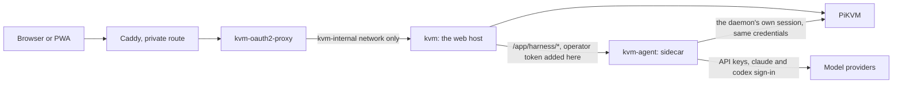

# Deploying the web host and its agent

The web host (`src/web-server.ts`, image `deploy/web`) serves the app and proxies the PiKVM. Chat needs
an agent, and the host does not run one: it forwards `/app/harness/*` to one of two places, chosen by
the environment and never by a request.

| Agent | Set | When |
| --- | --- | --- |
| **The agent sidecar** (`deploy/agent`) | `PIKVM_HARNESS_URL` + `PIKVM_HARNESS_TOKEN` | The hosted deployment. Chat works with nothing else running. |
| The desktop app | `PIKVM_DESKTOP_URL` + `PIKVM_DESKTOP_TOKEN` | The agent runs on a computer the host can reach. |

Set one pair. Half a pair, or both, stops the host at start with a message naming the variables.



`features.chat` in `GET /app/api/v1/state` is true while the agent answers `GET /api/health` (checked at
most every two seconds), not merely while a route to it is configured. A stopped sidecar shows the app's
"Chat is not available" page, and the workspace reconnects by itself when it returns.

## The sidecar

One container, two processes started the way the desktop app starts them (`src/main.ts`,
`src/harness-manager.ts`): the machine-control daemon (`pikvm-agent daemon`, the only thing that talks to
kvmd for the agent) and the chat harness (`pikvm-agent harness serve`). `deploy/agent/entrypoint.sh`
starts the daemon on `127.0.0.1` inside the container, waits for it, then starts the harness on
`0.0.0.0:47616`. If either process exits the container does, so the restart policy brings both back.

The image is built from `agent/pyproject.toml` and `agent/uv.lock` (`uv sync --frozen --no-dev`, no
vision extras: the daemon's OCR is the `tesseract` binary) plus the `claude` and `codex` CLIs, pinned by
build argument (`CLAUDE_CODE_VERSION`, `CODEX_VERSION`). The Gemini CLI is not installed and cannot be signed in from
the app; its row in Settings says so and points to adding a Gemini API key provider. The image is large (about 1.6 GB) because both CLIs are native
binaries of 300 to 450 MB.

Everything the sidecar is told, all environment:

| Variable | Required | Meaning |
| --- | --- | --- |
| `PIKVM_URL` | yes | The PiKVM, as the web host has it. |
| `PIKVM_USER` | no | kvmd user (default `admin`). |
| `PIKVM_PASSWORD` | yes | kvmd password. |
| `PIKVM_HARNESS_TOKEN` | yes | The operator capability, 32+ characters. The same value goes in the web host's `PIKVM_HARNESS_TOKEN`. |
| `PIKVM_HARNESS_ALLOWED_ORIGINS` | yes | Where the app is served from, e.g. `https://kvm.drewett.dev` (comma-separated). The harness accepts an approval only from these. |
| `PIKVM_VERIFY_TLS` | no | `1` to verify the Pi's certificate. Default off, as in the web host. |
| `PIKVM_AGENT_DATA` | no | The data volume (default `/data`). |
| `PIKVM_HARNESS_LISTEN` | no | Bind address (default `0.0.0.0:47616`). |

The daemon's two capabilities and the harness's agent and observer tokens are generated at each start
inside the container and never leave it. The sidecar publishes no port: put it on the same private
network as the web host and nothing else.

The data volume holds, and is the only thing that needs backing up:

| Path | What |
| --- | --- |
| `config/harness.yaml` | The harness config, created once by `harness init`. Holds providers and routes, never a secret. |
| `config/provider-keys.json` | API keys set from Settings, mode 0600, write-only from the browser. |
| `config/.pikvm-harness/` | Run history and screenshots. |
| `home/.claude`, `home/.codex` | The two CLIs' sign-ins (`HOME` is `/data/home`). The harness never reads them. |

### Why the origin setting exists

An approval is a `POST` the browser makes, and the harness refuses one whose `Origin` is not on its list
(`agent/pikvm_agent/harness/api.py`). Behind the web host that origin is the public one, so it has to be
said once. The sidecar passes it to `harness serve --allowed-origins`, together with
`--allow-remote-bind`, for that run only: the YAML is not rewritten. A wide bind with no origins, or an
origin that is not a bare `https://host`, is refused at start.

### First sign-in

1. Open Settings, then Providers. The page is the same on a phone.
2. **Sign in with an account.** Codex shows a link and a one-time code: open the link on any device and
   enter the code. Claude Code shows a link; open it, sign in, and paste the code the page shows into the
   box. The harness runs each CLI's own login and never sees its tokens.
3. **API keys.** Add a provider, paste the key. It is sent once, kept in `provider-keys.json`, and never
   shown again. An added provider is available in the chat model picker.

## The bsociety deployment

Not applied from this repo. `/srv/machines/bsociety/kvm/compose.yml` has `kvm` and `kvm-oauth2-proxy` on
`kvm-internal`. The change is: two environment lines on `kvm`, one new service, and one new key in
`/srv/machines/bsociety/.env`.

### `/srv/machines/bsociety/.env`

```
# 32+ characters, shared by kvm and kvm-agent. Generate with: openssl rand -hex 32
KVM_HARNESS_TOKEN=
```

`PIKVM_PASSWORD` is already there and is reused.

### On the `kvm` service, add to `environment`

```yaml
            PIKVM_HARNESS_URL: http://kvm-agent:47616
            PIKVM_HARNESS_TOKEN: ${KVM_HARNESS_TOKEN:?kvm harness token required}
```

### New service, beside `kvm`

```yaml
    # The agent behind Chat (deploy/agent in ~/dev/pikvm-desktop-agentic). The build
    # context in ./agent-app is generated there with `make agent-bundle` (builds/agent/)
    # and copied here, like ./app. It holds the daemon that drives the PiKVM, so it is on
    # kvm-internal only: nothing but the kvm container can reach it, and kvm adds the
    # token. The data volume carries the harness config, the 0600 key store and both
    # CLIs' sign-ins.
    kvm-agent:
        build:
            context: ./agent-app
            dockerfile: Dockerfile
        image: pikvm-agent:latest
        container_name: kvm-agent
        restart: unless-stopped
        environment:
            PIKVM_URL: https://pikvm.tail93a99.ts.net
            PIKVM_USER: admin
            PIKVM_PASSWORD: ${PIKVM_PASSWORD}
            PIKVM_HARNESS_TOKEN: ${KVM_HARNESS_TOKEN:?kvm harness token required}
            PIKVM_HARNESS_ALLOWED_ORIGINS: https://kvm.drewett.dev
        volumes:
            - /config/apps/kvm-agent:/data
        networks:
            - kvm-internal
        read_only: true
        tmpfs:
            - /tmp
        cap_drop:
            - ALL
        security_opt:
            - no-new-privileges:true
```

The container runs as uid 10001. Create the data directory before the first start:

```sh
sudo install -d -m 700 -o 10001 -g 10001 /config/apps/kvm-agent
```

It needs outbound internet (model APIs, and the CLIs' sign-in), which `kvm-internal` has because it is not
declared `internal`. Behind oauth2-proxy nothing else changes: `/app/harness/*` is not in
`OAUTH2_PROXY_SKIP_AUTH_ROUTES`, so it needs the sign-in like the rest of `/app/`.

### Build and deploy

```sh
# in ~/dev/pikvm-desktop-agentic
make web-bundle agent-bundle
rsync -a --delete builds/web/   bsociety:/srv/machines/bsociety/kvm/app/
rsync -a --delete builds/agent/ bsociety:/srv/machines/bsociety/kvm/agent-app/
# on bsociety, after the compose and .env edits above
docker compose -f /srv/machines/bsociety/kvm/compose.yml up -d --build kvm kvm-agent
```

Check: `docker logs kvm-agent` ends with `Uvicorn running on http://0.0.0.0:47616`,
`docker inspect -f '{{.State.Health.Status}}' kvm-agent` is `healthy`, and
`/app/api/v1/state` (signed in) reports `"chat": true`.

## The desktop route

`PIKVM_DESKTOP_URL` is the desktop app's console server (for example `http://fsociety.example.ts.net:25650`)
and `PIKVM_DESKTOP_TOKEN` its access token. That server mounts the harness at `/app/harness` itself and
attaches its own operator capability, so the web host forwards the path whole and authenticates as a client
of it. Same proxy, same health probe, same rule that the browser never holds a credential.

## The cursor report

When a person moves the pointer on the picture, the page tells the agent's daemon where it went
(`POST /app/daemon/cursor`, kvmd units): kvmd never broadcasts the position, and the daemon ends the agent's
control of the machine when a person takes the mouse. On the desktop the daemon is behind `/app/daemon`. A
hosted host has no daemon of its own, so it relays that one route, and no other under `/app/daemon` (they
answer 404), to the agent through the same upstream and credential as Chat: the sidecar's operator API takes it
at `POST /api/cursor` (operator token only; the model-side agent token is refused) and sends it to its daemon.
The page sends reports while `features.chat` is true.

## What the host does not forward

The proxy sets `Authorization` itself (whatever the browser sent is dropped) and does not forward the
browser's cookies, which belong to the sign-in in front of the host. A request without the
`x-pikvm-workspace: 1` header the app adds is refused before it reaches the agent. When the browser
leaves, an open event stream is closed upstream.

## Verified how

`docs/e2e/2026-11-02-chat-sidecar.md` records a run of this exact stack on one machine:
`deploy/e2e/compose.yml` brings up both images (with the bsociety hardening: read-only root, `/tmp` tmpfs,
no capabilities, `no-new-privileges`), a fake kvmd and a scripted model, and
`apps/web/e2e/chat-sidecar.e2e.mjs` drives it on an iPhone 13 and a desktop profile: a key set from
Settings, both CLI sign-ins reaching their link and code, a run streaming, a click and an approved Enter
arriving at the fake kvmd, a denied one not arriving, and the Chat page of a host whose agent is down.

Also checked by hand on that stack: stopping the sidecar flips `features.chat` to false within the two-second
cache and `/app/harness/*` answers 502; starting it brings Chat back in about ten seconds with the stored
keys intact (they live on the volume).

## Known limits

- The Gemini CLI is not in the image, and its sign-in is a terminal UI the harness cannot drive; use a Gemini
  API key provider.
- The image is about 1.6 GB (the two native CLIs are 750 MB of it).
- The sidecar's `HOME` is on the volume, so a CLI sign-in is as private as the volume's directory
  (mode 700, uid 10001). Anyone who can read the volume can use the signed-in account.
