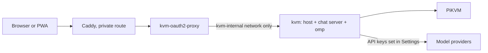

# Deploying the web host

One image, `deploy/Dockerfile`, holds everything: the web host (`src/web-server.ts`), which serves the app and
proxies the PiKVM, the chat server it runs in the same process, and omp's standalone binary, which is the agent.
There is no sidecar, no Python and no Bun. The agent is spawned by the host, once per active conversation, and
reaches the PiKVM only through the host's own tools.



## The image

```sh
make image                       # podman build --format docker -f deploy/Dockerfile -t pikvm-kvm:local .
make image IMAGE_TOOL=docker     # or docker; IMAGE=name:tag renames the result
```

Built from the repository root, in three stages:

1. **omp.** `scripts/fetch-omp.mjs` downloads the release asset for the image's architecture (`linux-x64` or
   `linux-arm64`, by `TARGETARCH`) and checks it against the sha256 in `deploy/omp.lock`. A mismatch fails the build.
2. **build.** `yarn install --immutable`, `yarn build` and the web app's build.
3. **runtime** (`node:22-bookworm-slim`). `tini`, `ca-certificates`, `sharp` (the build argument `SHARP_VERSION`,
   for screenshot resize and crop; a native addon with a prebuilt binary, so the image is glibc and not alpine),
   `dist/`, `apps/web/dist` and the binary at `/opt/omp/omp`.

It runs as uid 10001, writes only `/data` and `/tmp`, needs no capability, and has a healthcheck on `/app/login`.
The default posture is the one bsociety uses:

```yaml
read_only: true
tmpfs: [/tmp]
cap_drop: [ALL]
security_opt: ["no-new-privileges:true"]
```

podman builds OCI images by default, and OCI has no `HEALTHCHECK`; `make image` passes `--format docker` for podman.

### Environment

| Variable | Required | Meaning |
| --- | --- | --- |
| `PIKVM_URL` | yes | The PiKVM, e.g. `https://pikvm.example.ts.net`. |
| `PIKVM_USER` | no | kvmd user (default `admin`). |
| `PIKVM_PASSWORD` | yes | kvmd password. Held by the host only; never in the agent's environment, files or prompt. |
| `PIKVM_AUTH` | for `HOST=0.0.0.0` | `proxy`: an authenticating proxy is in front. The image sets `HOST=0.0.0.0`, so this is required in practice. |
| `PORT` | no | Listen port (default `8080`). |
| `PIKVM_DATA_DIR` | no | The data volume (image default `/data`). |
| `PIKVM_KEYBOARD_LAYOUT`, `PIKVM_JIGGLER` | no | As before. |
| `OMP_BIN` | no | The agent binary (image default `/opt/omp/omp`). |

`PIKVM_HARNESS_URL`, `PIKVM_HARNESS_TOKEN`, `PIKVM_DESKTOP_URL` and `PIKVM_DESKTOP_TOKEN` are gone: there is no
sidecar to point at.

The data volume holds, and is the only thing that needs backing up:

| Path | What |
| --- | --- |
| `settings.json` | The host's settings. |
| `chat/` | The chat database, per-conversation files, the agent's `HOME`, and provider keys entered in Settings (mode 0600, write-only from the browser). |

Model providers are set in the app: Settings, then Providers, then add a base URL and key. Sign-in with a provider
account (the old Claude and Codex CLI flows) is not part of this image.

## The bsociety change

Not applied from this repo. In `/srv/machines/bsociety/kvm/compose.yml`:

1. **`kvm` service.** Build the new image instead of the old one: copy the repository checkout (or a `git archive`
   of it) to the host and build from its root, e.g. `build: { context: ./app, dockerfile: deploy/Dockerfile }`.
   Delete the two `PIKVM_HARNESS_*` environment lines. Keep `PIKVM_URL`, `PIKVM_USER`, `PIKVM_PASSWORD`,
   `PIKVM_AUTH: proxy`, `PORT`, the `/data` volume and the hardening block above. The first start creates
   `/data/chat`; the volume is already owned by uid 10001.
2. **Remove `kvm-agent`**: the service, its `/config/apps/kvm-agent` volume directory, and `./agent-app`.
3. **`/srv/machines/bsociety/.env`**: remove `KVM_HARNESS_TOKEN`, and any `KVM_HARNESS_*`. `PIKVM_PASSWORD` stays.
4. **oauth2-proxy**: nothing changes. Chat's API lives under `/app/` and sits behind the sign-in like the rest;
   the agent's own surface is a loopback listener inside the container and is not reachable from outside.
5. The old sidecar's provider keys and CLI sign-ins are not migrated. Enter the keys again in Settings.

```sh
# on bsociety
docker compose -f /srv/machines/bsociety/kvm/compose.yml up -d --build kvm
docker inspect -f '{{.State.Health.Status}}' kvm      # healthy
```

The model needs outbound internet; `kvm-internal` has it because it is not declared `internal`.

## Sandboxing the agent

The agent runs the *computer* profile: its tools are `ask`, `todo` and the PiKVM tools (`mcp__pikvm_*`). It has no
tool that reads files, runs commands or makes requests, and there is no process sandbox in the image (no bubblewrap,
no socat), so no relaxed seccomp on the container that holds the PiKVM password. The residual risk is a bug in omp or
in the tool allow-list, which is the reason to keep the container's default hardening.

## Verified how

`docs/e2e/2026-11-03-image-and-appimage.md` records the image and the Linux AppImage running against a fake kvmd and
a scripted model.

`deploy/e2e/compose.yml` is that stack for a person: `make image`, then `podman compose -f deploy/e2e/compose.yml up`,
then Settings, Providers, base URL `http://fake-model:9000/v1`.

## Known limits

- Sizes: see the e2e record. omp's binary is about 277 MB of the image.
- The image is `linux/amd64` or `linux/arm64`; omp has no other Linux build pinned.
- `docker compose` and `podman compose` both work; `deploy/agent` (the old sidecar's Dockerfile) remains in the
  repository until the Python code is removed, and nothing here uses it.
