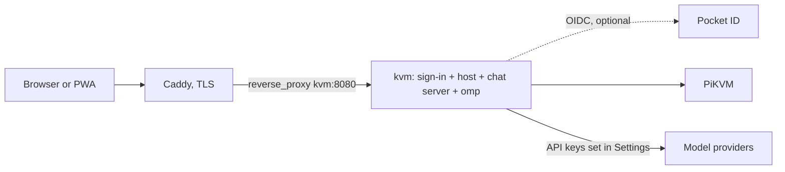
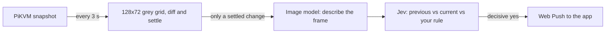

# Deploying the web host

One image, `deploy/Dockerfile`, holds everything: the web host (`src/web-server.ts`), which serves the app and
proxies the PiKVM, the chat server it runs in the same process, and omp's standalone binary, which is the agent.
There is no sidecar, no Python and no Bun. The agent is spawned by the host, once per active conversation, and
reaches the PiKVM only through the host's own tools.



## The image

```sh
make image                       # podman build --format docker -f deploy/Dockerfile -t pikvm-kvm:local .
make image IMAGE_TOOL=docker     # or docker; IMAGE=name:tag renames the result
```

Built from the repository root, in three stages:

1. **omp.** `scripts/fetch-omp.mjs` downloads the release asset for the image's architecture (`linux-x64` or
   `linux-arm64`, by `TARGETARCH`) and checks it against the sha256 in `deploy/omp.lock`. A mismatch fails the build.
2. **build.** `yarn install --immutable`, `yarn build` and the web app's build.
3. **runtime** (`node:22-bookworm-slim`). `tini`, `ca-certificates`, `sharp` (the build argument `SHARP_VERSION`,
   for screenshot resize and crop; a native addon with a prebuilt binary, so the image is glibc and not alpine),
   `dist/`, `apps/web/dist` and the binary at `/opt/omp/omp`.

It runs as uid 10001, writes only `/data` and `/tmp`, needs no capability, and has a healthcheck on `/app/login`.
The recommended posture is:

```yaml
read_only: true
tmpfs: [/tmp]
cap_drop: [ALL]
security_opt: ["no-new-privileges:true"]
```

podman builds OCI images by default, and OCI has no `HEALTHCHECK`; `make image` passes `--format docker` for podman.

### Environment

| Variable | Required | Meaning |
| --- | --- | --- |
| `PIKVM_URL` | yes | The PiKVM, e.g. `https://pikvm.example.ts.net`. |
| `PIKVM_USER` | no | kvmd user (default `admin`). |
| `PIKVM_PASSWORD` | yes | kvmd password. Held by the host only; never in the agent's environment, files or prompt. |
| `PIKVM_ACCESS_TOKEN` | one method needed | Sign-in method 1, the access token: `Authorization: Bearer <token>` for a remote PiKVM Desktop or a script, and a token field on the sign-in page. A wrong bearer gets 401; unset, every bearer is refused. |
| `PIKVM_SYNC_ALLOW_HTTP` | no | `1` accepts a bearer over plain http from a non-loopback peer. Default: refused, so a token never crosses a network in clear. |
| `PIKVM_LOGIN_USER`, `PIKVM_LOGIN_PASSWORD_HASH` or `PIKVM_LOGIN_PASSWORD` | one method needed | Sign-in method 2, a password: the user name and an scrypt hash (`node dist/web-server.js --hash-password`) or the plain password. |
| `PIKVM_OIDC_ISSUER`, `PIKVM_OIDC_CLIENT_ID`, `PIKVM_OIDC_CLIENT_SECRET`, `PIKVM_OIDC_SCOPES`, `PIKVM_OIDC_ALLOWED_GROUPS`, `PIKVM_OIDC_ALLOWED_EMAILS`, `PIKVM_OIDC_ALLOWED_SUBJECTS` | one method needed | Sign-in method 3, OpenID Connect, with `PIKVM_PUBLIC_URL`. Every variable is explained under "Running it". |
| `PIKVM_PUBLIC_URL` | for OIDC | The https origin users see, e.g. `https://kvm.example.com`; the OIDC redirect URI is `<PIKVM_PUBLIC_URL>/app/auth/callback`. An https value also marks the session cookie `Secure` and lets the password and token forms through. |
| `PIKVM_TRUST_PROXY` | no | `1`: believe `X-Forwarded-Proto` and the last `X-Forwarded-For` hop from the reverse proxy in front. Unset: those headers are ignored. |
| `PIKVM_SESSION_SECRET` | no | At least 32 characters, the key that signs session cookies. Unset: a random one is kept in `<PIKVM_DATA_DIR>/session-secret`. |
| `PORT` | no | Listen port (default `8080`). |
| `PIKVM_DATA_DIR` | no | The data volume (image default `/data`). |
| `PIKVM_KEYBOARD_LAYOUT`, `PIKVM_JIGGLER` | no | As before. |
| `OMP_BIN` | no | The agent binary (image default `/opt/omp/omp`). |
| `PIKVM_WATCH_INTERVAL_MS` | no | How often the screen watch looks at the screen (default `3000`; values under `2000` are raised to `2000`). |
| `PIKVM_WATCH_SETTLE_MS` | no | How long the screen must stay still after it changed before the change counts (default `6000`). |
| `PIKVM_WATCH_MIN_GAP_SEC` | no | At most one model check per watch in this many seconds (default `60`). |
| `PIKVM_WATCH_DAILY_CAP` | no | At most this many model checks per watch in 24 hours (default `200`). |
| `PIKVM_PUSH_SUBJECT` | no | The VAPID contact (`mailto:` or `https:`) for a push whose device did not report the address it was opened at. Normally unset: each device reports it. |
| `PIKVM_PUSH_ALLOW_LOCAL` | no | `1` accepts push subscriptions on any address, loopback and plain http included. For tests and local runs only: left off, only the push services browsers use are accepted. |

`PIKVM_HARNESS_URL`, `PIKVM_HARNESS_TOKEN`, `PIKVM_DESKTOP_URL` and `PIKVM_DESKTOP_TOKEN` are gone: there is no
sidecar to point at.

The data volume holds, and is the only thing that needs backing up:

| Path | What |
| --- | --- |
| `settings.json` | The host's settings. |
| `chat/` | The chat database, per-conversation files, the agent's `HOME`, and provider keys entered in Settings (mode 0600, write-only from the browser). |
| `push-vapid.json` | The server's Web Push key pair, made once on first use (mode 0600). **Back it up with the volume and never delete it**: a new pair orphans every device's subscription. |
| `chat/users/<id>/watch/` | One user's screen watch (directory 0700, files 0600): `settings.json` (on or off, the rule, the image model), `checks.jsonl` (one line per check, rotated at 512 KB to `checks.jsonl.1`) and `push-subscriptions.json` (the devices). Today there is one user, `operator`. |

Model providers are set in the app: Settings, then Providers, then add a base URL and key. Sign-in with a provider
account (the old Claude and Codex CLI flows) is not part of this image.

## Screen watch (notifications to the installed app)

The server can watch the PiKVM's screen by itself, with no browser open, and send a notification to the installed home-screen
app when the screen changes in a way you asked to hear about. It is per user and off until switched on in Settings,
Notifications. The watch is one poller on the PiKVM, shared by everyone who has theirs on, and it runs only while at least one
person does.



1. **The local diff (free).** Every `PIKVM_WATCH_INTERVAL_MS` (3 s) the host takes `/api/streamer/snapshot`, reduces it to a
   128 x 72 grey grid (a cell is 10 px of a 1280 px frame, about half a character of terminal text) and compares it with the last
   settled frame. A cell has changed when its grey level moved by at least 10 of 255; the screen has changed when at least
   **0.3 %** of the cells did (28 of 9216). Measured on the frames of the E2E run: a blinking caret is 0.11 %, a progress bar
   ticking 0.05 %, JPEG re-encoding or codec-sized noise 0 %; a new line of terminal output is 0.4 %, a dialog's text changing
   0.5 %, a dialog opening 14 %. A change counts only once it has **settled**: no further change of that size between two looks
   for `PIKVM_WATCH_SETTLE_MS` (6 s). A window sliding open, a spinner, a scrolling log or a video never settles and so never
   fires until it stops; a flash that returns to what was there is dropped. Nothing else runs unless this fires. There are no
   masked regions: a clock large enough to pass the threshold would need one, and the grid is shared by every user's watch, so it
   is not offered.
2. **The image model.** A settled change is one *check*. The new frame (scaled to 1280 px on its long edge) is described by an
   OpenRouter image model in one to three factual sentences: which application, any dialog or error and its text. The first
   check also describes the frame before it, once; afterwards the previous description is the last one.
3. **Jev.** `typesafe/jev-1.14` (the decisions model at `/api/alpha/decisions`, not the router) is asked one yes/no question with
   state `{previous, current, rule}`; `rule` is your sentence from Settings, or `(none)`. Only a probability of **0.85 or more**
   is a yes and **0.15 or less** a no; anything between sends nothing and is logged as undecided. Answers are cached by request
   hash (the same two descriptions and rule cost nothing the second time; the log says `fromCache`); 429 and 5xx are retried
   with backoff.
4. **The push.** A yes sends a Web Push (VAPID, encrypted) to every device of that user. The notification text is built by the
   host from the image model's description (its first sentence, and the second while both fit in 160 characters; the model is told to lead with the dialog, error or status line and its text), never by Jev; a tap opens `/app/`.
   A push service that answers 404 or 410 says the device is gone and its subscription is removed.

Signal: while kvmd reports no video source (its snapshot answers 503), nothing is compared: a black screen is not a change. Two
looks in a row with no signal count as one *signal lost* check (the same Jev question, with the description "no video signal" and
no image call); when the signal returns, the first settled picture is checked against that. The PiKVM being unreachable is not a
lost signal.

### What it costs, and the bounds

It uses the key stored in Settings, Providers (the provider named `openrouter`, or any entry whose address is on
openrouter.ai). **Without one the watch cannot be switched on** and the Settings page says why; a key removed later makes every
change log "no OpenRouter key" and call nothing.

- **Image model: `google/gemma-3-12b-it`**, $0.05 per million input tokens and $0.15 per million output tokens on OpenRouter
  (read 2026-11-03 from `/api/v1/models`, input modalities text and image). OpenRouter reported **$0.00003 to $0.00004 per
  described 1280 x 720 frame**. It is a setting (Settings, Notifications, Image model): any OpenRouter model that accepts
  images. Tried on the same two frames and not chosen: `amazon/nova-lite-v1` ($0.00014 a frame, terse), `mistralai/mistral-small-3.2-24b-instruct`
  ($0.00011), `z-ai/glm-5.3-flash` ($0.00035), `google/gemma-3-4b-it` ($0.00002, but it missed the error text) and
  `qwen/qwen3.7-flash` (it spent its output on reasoning and returned no text).
- **Jev:** $0.042 per million input tokens, output free: about $0.00002 per question.
- **A check** is about $0.0001 the first time (two descriptions) and about $0.00006 after that.
- **Bounds** (per watch, whatever the screen does): at most **one check per 60 s**; a change inside that gap waits, and only the
  newest one is checked when it ends (the ones it replaced are logged as skipped); at most **200 checks in any 24 hours**,
  counted from the log so a restart does not reset it (worst case about 1.2 cents a day); one check at a time.
- The frames leave the host: a screenshot of the target goes to OpenRouter and the model provider behind it. Do not switch the
  watch on for a target whose screen must not leave the building.

### The log: why it fired or did not

`chat/users/<id>/watch/checks.jsonl`, one JSON object per line, also shown (newest first) under Settings, Notifications, Recent
checks and at `GET /app/api/v1/watch/checks`:

```json
{"t":1762171234567,"at":"2026-11-03T12:00:34.567Z","kind":"change","score":0.056,"outcome":"pushed","asked":true,
 "model":"google/gemma-3-12b-it","rule":"tell me when the install finishes or an error shows",
 "previous":"A terminal runs apt install ... 68%.","description":"A dialog titled Installation failed ...",
 "noul":0.96,"costUsd":0.00009,"push":{"sent":1,"removed":0,"failed":0}}
```

`kind` is `change`, `signal-lost` or `test`; `outcome` is `pushed`, `no`, `undecided`, `skipped` (no model was asked; `reason` says
why: no key, daily cap, replaced by a newer change) or `error` (`reason` says what failed, including a yes that reached no device).
`asked` is what the daily cap counts.

### Notifications on the iPhone

Web Push works on iOS 16.4 and later **only for the app added to the Home Screen and opened from its icon**, never in a Safari
tab. Add it (Safari, Share, Add to Home Screen), open it from the icon, go to Settings, Notifications and switch it on: the
permission prompt comes from that tap. An app added before this feature existed does not need adding again; open it once so the
new worker (`/app/sw.js`) installs. If the page says notifications are blocked, turn them on in the iPhone's Settings,
Notifications, PiKVM. Nothing new is public: the worker was already a public path, and the push reaches it from Apple, not
through the host's sign-in. The host must be able to reach the push services (`web.push.apple.com`,
`fcm.googleapis.com`) over https.

### Switching it off

- Settings, Notifications, switch off: the poller stops at once if nobody else has it on, and the PiKVM is no longer asked for
  snapshots. Remove this device (same page) forgets a device.
- Without a browser: set `"enabled": false` in `chat/users/<id>/watch/settings.json` and restart the container, or delete
  `push-subscriptions.json` to stop the notifications and keep the watch's log.
- To stop all spending: remove the OpenRouter provider in Settings, Providers. Nothing is asked of a model without it.

## Running it

The host signs users in itself. There is no proxy or identity gateway to run in front of it, and none is needed for sign-in. A TLS
reverse proxy (Caddy, below) is still how you get https, and the host needs https for passwords and tokens to travel (see
"Where a secret may travel").

With no method configured the host binds only to loopback and refuses any other `HOST` with a message naming the three
groups below. The image sets `HOST=0.0.0.0`, so a container needs at least one method to start. Configure any combination.

### The three ways in

**1. Access token.** Set `PIKVM_ACCESS_TOKEN` to a long random string (`openssl rand -hex 32`).

- A remote PiKVM Desktop or a script sends `Authorization: Bearer <token>` on every route the console reaches. The host accepts
  it only with that exact token and answers 401 otherwise. No `?token=` is read; a request carrying an `Origin` that is not this
  host's own is refused (a browser page must never ride the token); plain http from a non-loopback peer is refused unless
  `PIKVM_SYNC_ALLOW_HTTP=1` (or the request is https, see below).
- The sign-in page also has a token field: type the same token and the host sets a session cookie.
- A bearer is never turned into a cookie, and a cookie is never accepted as a bearer.

**2. Password.** Set `PIKVM_LOGIN_USER` and a hash of the password:

```sh
docker run --rm -it pikvm-kvm:<tag> node dist/web-server.js --hash-password   # asks for the password without echoing it
printf '%s' "$PASSWORD" | docker run --rm -i pikvm-kvm:<tag> node dist/web-server.js --hash-password
```

It prints one line, `scrypt$N$r$p$salt$hash`, and nothing else: that is `PIKVM_LOGIN_PASSWORD_HASH`. In a `.env` file wrap it in
single quotes so compose leaves the `$` alone; written in the compose file itself, each `$` is `$$`. The host accepts N of 16384 or
more. `PIKVM_LOGIN_PASSWORD` takes the password itself instead; it works, but a
hash is better because the environment is easy to leak. Set one of the two.

- The sign-in page has a user name and password form. Scripts can use `Authorization: Basic` with the same credential.
- The user name and the password are each compared in constant time, and the password is always checked (against a dummy hash when
  the user is unknown), so neither how long a refusal takes nor its wording says which half was wrong: the page says
  "That did not work."
- Basic is judged by these rules only. A bearer is not a password and a password is not a bearer.

**3. OpenID Connect.** The host is the relying party of any OIDC provider (Pocket ID, Keycloak, Authentik, ...), directly. No
oauth2-proxy.

| Variable | Meaning |
| --- | --- |
| `PIKVM_OIDC_ISSUER` | The provider's issuer URL, e.g. `https://id.example.com`. https only (plain http is accepted only to loopback, for tests). The host reads `<issuer>/.well-known/openid-configuration`. |
| `PIKVM_OIDC_CLIENT_ID` | The client id. |
| `PIKVM_OIDC_CLIENT_SECRET` | The client secret. Unset: a public client, protected by PKCE alone. |
| `PIKVM_OIDC_SCOPES` | Default `openid email profile groups`. |
| `PIKVM_OIDC_ALLOWED_GROUPS` | Comma list. A user passes if their `groups` claim holds any of them. |
| `PIKVM_OIDC_ALLOWED_EMAILS` | Comma list, compared case-insensitively. A user passes if their `email` is in it **and** the id_token says `email_verified: true`; a missing claim, `false` or the string `"true"` does not count. |
| `PIKVM_OIDC_ALLOWED_SUBJECTS` | Comma list of `sub` values, exact and case-sensitive, for a provider that sends neither groups nor a verified email. |
| `PIKVM_PUBLIC_URL` | The https origin users see, e.g. `https://kvm.example.com`. Required. The redirect URI is `<PIKVM_PUBLIC_URL>/app/auth/callback`. |

A user passes with any one of the three rules. With all three lists empty **every user the provider signs in is refused**: the host says so at startup.

The flow is authorization code with PKCE (S256), `state` and `nonce`, which a short-lived signed HttpOnly cookie ties to the browser
that started it. The id_token is verified with `jose`: its signature against the issuer's JWKS (cached, fetched again for an unknown
key id at most every 30 seconds), the algorithm (RS256, ES256 or EdDSA only; `none` and HS256 are refused), `iss`, `aud` (your
client id), `exp` and `nbf` (60 seconds of skew), and the `nonce`. Only then do the allow rules run. Groups and email are read
from the id_token, so the provider must put them there (Pocket ID does when the `groups` and `email` scopes are requested).

In **Pocket ID**, create an OIDC client with the callback URL `<PIKVM_PUBLIC_URL>/app/auth/callback` (for example
`https://kvm.example.com/app/auth/callback`), give the client to a user group, and name that group in
`PIKVM_OIDC_ALLOWED_GROUPS`. The sign-in page then shows "Sign in with id.example.com".

### Sessions

The form methods and OIDC end in a signed cookie (`__pikvm_session`: HMAC-SHA256, HttpOnly, SameSite=Lax, Path=/). It holds the
method, the subject and its expiry, never a secret. It lasts 30 days and is renewed when a request finds it more than a day old.
It stops working when the token, the password, or the OIDC issuer, client or allow lists change. `GET /app/api/v1/session` tells the app who it is signed in as (`signIn`, `method`, `subject`, `canSignOut`; never a secret); only a cookie session can be signed out. `/app/logout` clears the cookie
in the browser; the cookie itself is stateless, so a copy of it stays valid until its expiry unless you change the secret or the
credential.

The key is `PIKVM_SESSION_SECRET` (at least 32 characters). Unset, the host makes 32 random bytes once and keeps them in
`<PIKVM_DATA_DIR>/session-secret` (mode 0600, written atomically), so sessions survive a restart and a new image on the same volume.
Deleting that file signs everyone out.

WebSocket upgrades use the same cookie and keep the chat socket's same-origin check. The sign-in form POST must come from a page of
this host (a foreign `Origin`, or `Sec-Fetch-Site: cross-site`, is refused). The return path after sign-in (`next`) must be a
relative path starting with a single `/`; anything else goes to `/app/`.

### Where a secret may travel

The password form, the token form and `Authorization: Basic` are refused with `403 Sign in over https.` over plain http from any
peer that is not this machine. There is no setting that turns this off. The host reads a request as https when
`PIKVM_PUBLIC_URL` is an https URL, or, only with `PIKVM_TRUST_PROXY=1`, when the proxy's last `X-Forwarded-Proto` says `https`
(a trusted `X-Forwarded-Proto: http` is refused even from a local peer). A bearer follows the same test, and
`PIKVM_SYNC_ALLOW_HTTP=1` is the one switch that lets a bearer through plain http from a remote peer.

`PIKVM_TRUST_PROXY=1` also makes the host read `X-Forwarded-For` (its last entry, the hop the proxy appended) as the client
address for the rate limit, and marks the cookie `Secure` from `X-Forwarded-Proto`. Leave it unset unless a proxy you control is the
only thing that can reach the port: anyone who can reach the port directly could forge those headers. Unset, they are ignored and the
socket's own address is used. The session cookie is also `Secure` whenever `PIKVM_PUBLIC_URL` is https.

### Failed attempts

Failed sign-ins (the form, Basic, a wrong bearer) are counted per client address. The first three are free; each one after that
doubles the wait before that address may try again (1 s, 2 s, 4 s, up to 15 minutes). While it waits every attempt, the right
password included, gets `429` with `Retry-After`. A success clears the address. Sixty failures from all addresses within a minute
make every attempt wait for the minute to pass. A session already signed in is never slowed. The submitted password and token are
never logged: a refusal logs its kind and the address only.

### Using this host as a server

A remote PiKVM Desktop (or a CLI) can use this host as its server: give it the host's URL and `PIKVM_ACCESS_TOKEN` as its bearer
token. The remote sends `Authorization: Bearer <token>`, which the host judges by the bearer rules alone: valid, or refused 401. It
does not fall back to a cookie or to Basic, and it never sets a cookie. Serve the host over https and leave `PIKVM_SYNC_ALLOW_HTTP`
unset. With `PIKVM_ACCESS_TOKEN` unset every bearer is refused.

### A compose file for the host

No proxy and no oauth2 service: the host and its data. Set whichever methods you want; this one uses a password and Pocket ID.

```yaml
services:
    kvm:
        image: pikvm-kvm:<tag>              # built with `make image`, see above
        container_name: kvm
        restart: unless-stopped
        environment:
            PIKVM_URL: https://pikvm.example.ts.net
            PIKVM_USER: admin
            PIKVM_PASSWORD: ${PIKVM_PASSWORD:?set it in .env}
            PIKVM_PUBLIC_URL: https://kvm.example.com
            PIKVM_TRUST_PROXY: "1"          # Caddy below is the only thing that reaches the port
            # 1. the access token, for the desktop app's server link and scripts
            PIKVM_ACCESS_TOKEN: ${KVM_ACCESS_TOKEN:?openssl rand -hex 32}
            # 2. a password (use $$ for each $ of the hash in a compose file)
            PIKVM_LOGIN_USER: kieran
            PIKVM_LOGIN_PASSWORD_HASH: ${KVM_LOGIN_PASSWORD_HASH:?node dist/web-server.js --hash-password}
            # 3. OpenID Connect (Pocket ID): redirect URI https://kvm.example.com/app/auth/callback
            PIKVM_OIDC_ISSUER: https://id.example.com
            PIKVM_OIDC_CLIENT_ID: ${KVM_OIDC_CLIENT_ID:?}
            PIKVM_OIDC_CLIENT_SECRET: ${KVM_OIDC_CLIENT_SECRET:?}
            PIKVM_OIDC_ALLOWED_GROUPS: kvm
            PIKVM_KEYBOARD_LAYOUT: us
            PORT: "8080"
        volumes:
            - /path/to/kvm-data:/data       # the only thing to back up
        networks:
            - web                           # shared with Caddy; no port is published
        read_only: true
        tmpfs:
            - /tmp
        cap_drop:
            - ALL
        security_opt:
            - no-new-privileges:true

networks:
    web:
        external: true                      # the network your Caddy container is on
```

Caddy, on the same network, terminates TLS and needs one line for the site:

```
kvm.example.com {
    reverse_proxy kvm:8080
}
```

Caddy keeps the original `Host` and adds `X-Forwarded-For` and `X-Forwarded-Proto`, which is what `PIKVM_TRUST_PROXY=1` reads. Nothing
needs to be skipped or let through for sign-in: the host answers its own public paths (`/app/login`, `/app/auth`,
`/app/auth/callback`, the web manifest, the service worker, the icons and the iPhone launch images) without a session and
everything else, Chat's API and sockets included, needs one.

The model provider is called from this container, so the network it is on must have outbound internet: do not declare it `internal`.

**Volume ownership.** The image runs as uid 10001 and writes `/data`, including the `chat/` directory it creates on first
start. Either give that uid the volume (`chown -R 10001:10001 /path/to/kvm-data`), or add `user: "<uid>:<gid>"` to the service
to run as the volume's own owner. With neither, Chat cannot create `/data/chat` and the host stops at start.

### Image delivery: `docker save | ssh docker load`

To run exactly the image the e2e suites ran against, build it in a clean checkout of the tested commit and send the image
itself rather than building on the server:

- the image id is compared after the load, so what is deployed is byte-for-byte what was tested;
- a build on the server needs the toolchain's network at that moment (npm registry, GitHub for omp, Debian mirrors) and a build
  cache there, and a failure leaves a half-built tag. A transfer is one compressed stream of the final image;
- the compose file stops building anything, so nothing on the server drifts from the repository.

```sh
# on the workstation, in a clean checkout of the commit to ship (not a dirty tree)
git status --short                                  # must print nothing
SHA=$(git rev-parse --short=8 HEAD)
make image IMAGE_TOOL=docker IMAGE=pikvm-kvm:$SHA   # fails if omp's sha256 does not match deploy/omp.lock
docker image inspect -f '{{.Id}}' pikvm-kvm:$SHA    # note this id
docker save pikvm-kvm:$SHA | gzip | ssh your-server 'gunzip | docker load'
ssh your-server "docker image inspect -f '{{.Id}}' pikvm-kvm:$SHA"   # must be the same id
```

### Verify

```sh
docker inspect -f '{{.State.Health.Status}} {{.HostConfig.ReadonlyRootfs}} {{.Config.User}}' kvm   # healthy true <user> (after ~15 s)
docker logs kvm 2>&1 | grep -E '\[web\]|\[chat\]'    # "[web] console on http://0.0.0.0:8080/ ..." and "[chat] up, agent /opt/omp/omp"
curl -sI https://kvm.example.com/app/manifest.webmanifest | head -1   # HTTP/2 200 (the signed-out route)
```

Then in a signed-in browser at `https://kvm.example.com/app/`:

1. The KVM tab shows the picture.
2. Settings, Providers: add a model key. The models appear in Chat.
3. Chat: send a message and read the reply. If Chat says it is offline, the socket was refused: it needs the browser's `Origin` to equal the
   `Host` it reaches the container with, or `X-Forwarded-Host`; most proxies keep the original `Host` by default, so this only
   happens if a hop was changed. `docker logs kvm` shows nothing for a refused socket; the browser's network panel shows a 403 on `/app/chat/ws`.
4. Ask the agent to look at the screen. The KVM tab shows "Agent is working", a tap on the picture takes control back, and Stop ends the run.

`docker stats kvm --no-stream` once while a conversation runs: the container holds the host plus one omp process per active conversation,
and the compose file above sets no memory limit.

### Updating and rolling back

Before switching to a new image, keep the way back: tag the running image (`docker tag pikvm-kvm:<old> pikvm-kvm:previous`) and copy the
data volume's small files (`settings.json`, `macros.json`) aside. To roll back, point the compose file at the old tag and
`docker compose up -d kvm`. The data stays compatible between builds that share a data layout; if an older build misreads
`settings.json` after a run of the new one, restore the copy.

## Sandboxing the agent

The agent runs the *computer* profile: its tools are `ask`, `todo` and the PiKVM tools (`mcp__pikvm_*`). It has no
tool that reads files, runs commands or makes requests, and there is no process sandbox in the image (no bubblewrap,
no socat), so no relaxed seccomp on the container that holds the PiKVM password. The residual risk is a bug in omp or
in the tool allow-list, which is the reason to keep the container's default hardening.

## Verified how

`docs/e2e/2026-11-03-image-and-appimage.md` records the image and the Linux AppImage running against a fake kvmd and
a scripted model.

`deploy/e2e/compose.yml` is that stack for a person: `make image`, then `podman compose -f deploy/e2e/compose.yml up`,
then Settings, Providers, base URL `http://fake-model:9000/v1`. `deploy/e2e/up-inspectable.sh up` runs the same image with its
processes and `/data` readable by the invoking user, which `apps/web/e2e/chat.e2e.mjs` needs to inspect the agent (see
`docs/e2e/README.md`).

## The shared cursor

`GET /app/api/v1/cursor` is a server-sent-events stream behind the same gate as the rest of `/app/api` (so nothing new is public
behind the sign-in). Each event is `{x, y, source, seq}`: where the target's pointer is, in kvmd's own units (a fraction of the
screen, so any resolution), who moved it (the page's client id, `agent` for the chat agent's tools, or `socket-N` for a client that
named none) and a sequence number. The host learns positions from each page's `/api/ws` input socket (the page adds `?client=<id>`,
which the host takes off before kvmd sees the URL) and from the agent's mouse tools; at most one event goes out per frame, and a new
stream starts with the current position. A relative-mouse target is tracked from the last known position and clamped (its start is
unknown until the first absolute move or agent move, and the pointer's own acceleration is not known, so it drifts until the next
absolute move); a resolution change keeps an absolute position and keeps the pixel of a relative one. A proxy in front must not
buffer it (the response sends `x-accel-buffering: no`).

## Known limits

- Sizes: see the e2e record. omp's binary is about 277 MB of the image.
- The image is `linux/amd64` or `linux/arm64`; omp has no other Linux build pinned.
- `docker compose` and `podman compose` both work.
- Screen watch: delivery to a real iPhone is not verified (there is no iPhone here; headless Chrome in the iPhone 13 profile, with
  its own push service, stood in for the installed app). The diff compares grey levels on a 128 x 72 grid: a change that moves less
  than 10 of 255 on fewer than 0.3 % of the cells (a few characters of dim text) is not seen, and a screen that never stops
  changing (a video, a scrolling log) never settles and so is never checked.
